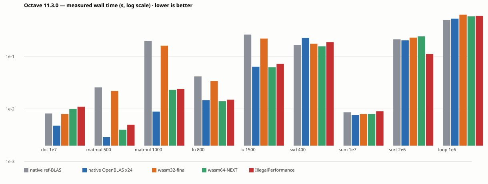
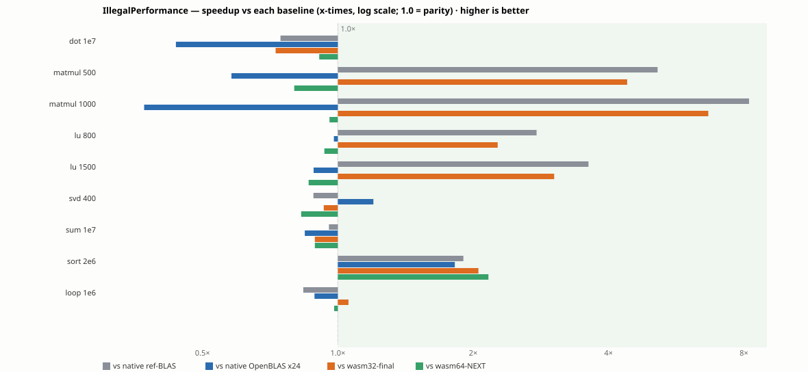

# Octave-Full-Wasm

[English](README.md) · [中文](README.zh.md) · [Deutsch](README.de.md)

GNU Octave 11.3.0 compiled to WebAssembly — a full numerical computing environment
(interpreter, BLAS/LAPACK, plotting, ~500 packages) running **entirely in your browser**:
pure client-side compute, **no server-side execution**.

**Current production lane: `w64` (WebAssembly memory64 + threads + relaxed-FMA OpenBLAS
+ mimalloc + a Rust `sort` kernel)**, shipped behind the same web UI as every other lane.
All numerical results are IEEE 754 binary64 — audited explicitly (below).

Toolchain: Emscripten **6.0.12** (all three lines rebuilt and shipped; the
The three-line 6.0.12 rollout is written up in `build/113/NOTES-emsdk-upgrade.md` §8.8.
See `build/113/NOTES-emsdk-upgrade.md` §8.9 for the per-line acceptance triage.

All three lines are **pushed and in sync** (local = origin = mirror), each rebuilt and verified under Emscripten 6.0.12.

Downstream integration with the browser clang+lld toolchain ([LLVM-wasm](https://github.com/ArchivalEra/LLVM-wasm)) is audited in `.scratch/open-questions/issues/65-clang-wasm-toolchain-host-integration.md`.

Site asset bundles are audited per batch: regenerate `site/assets/m/*.js` from their `build/` sources and compare hashes (mount points come from `build/assets-meta.json`, *not* guessed).

`pkg load <name>` now resolves **where a package comes from** before firing: site-shipped assets go through `OctaveAssets.load`, shelf (Forge catalog) packages through `OctaveAssets.install` (same-origin tarball + sha256 + in-engine gunzip/untar). **Shipped to 8761 and verified in-browser** (real tarball download + `csaps` bit-identical to host Octave). See `build/113/NOTES-forge-ondemand.md` §10 (T4) and the acceptance suite `test/browser/accept-catalog-load.mjs` (27/0, incl. 4 reverse assertions).

Installing the Forge `datatypes` package from the shelf makes the **modern MATLAB types** work: `table([1;2;3],{'a';'b';'c'})` returns `class=table` (height 3, width 2), `string(42)` gives `"42"`. Unimplemented MATLAB names now report Octave's real message ("belongs to the 'datatypes' package … not installed") instead of a `makeinfo` subprocess error. See `build/113/REQUIREMENTS-store-and-matlab.md`. (`help sin`/`help ode45`/`lookfor` are unaffected; the three help suites now assert `__makeinfo__` resolves to the sanctioned webshims downgrade.)

This engine already has everything a Simulink-style **block-diagram** backend needs — state-space/transfer-function blocks, `ode45`, **stiff `ode15s`**, LQR, `zpkdata` (probe `test/browser/probe-blockdiag-backend.mjs`, 6/0). So a block-diagram frontend can be built **on this engine** (a separate JS repo) rather than pulling in a second runtime like Pyodide. See `build/113/NOTES-plugin-survey.md`.

That survey also covers what this engine **cannot** reach: MATLAB has three axes (language / Simulink / Simscape), and we cover the first two — **non-causal physical modelling (Simscape) is zero-covered here**, and **OpenModelica** is the realistic answer for it (its wasm path lives in the official repo, has a Rust rewrite, and ships a browser FMI simulator; AGPLv3/OSMC-PL). See the survey's §8.

A follow-up **experiment confirmed Modelica runs in the browser**: a third-party OpenModelica→wasm port runs a full `parse → C → in-browser emcc+wasm-ld → simulate → plot` cycle on `BouncingBall.mo` (evidence: `build/113/evidence-omc-web-demo.png`; record: `build/113/NOTES-experiment-omc-wasm.md`). So "Modelica on the web" is proven, not speculative — though that third-party route's solver coverage is narrow (Euler/RK/dassl).

The **official** route is a first-class CMake target in OpenModelica's own tree (`rust_omc.cmake`: `RUST_OMC_WASM_RUNTIME`, `wasm32-wasip1` cross-compile, `omc.wasm`, prebuilt-artifact hand-off) — i.e. the same shape as this repo's own pipeline (upstream submodule + pin + cross-compile + same-origin hosting). So it is built the way we build Octave, not by copying a third-party recipe (see §11).

And it can share the **same page** — measured, not assumed: this engine solves **index-1 DAE** (`ode15i`, `Mass` matrix; an RC circuit gives V(5)=0.9931 vs theory 0.9933) but **not index-3** (a constrained pendulum fails), and index reduction is exactly what the OpenModelica compiler does. Both engines read/write `.mat`, which is what omc-web already dumps. So the pairing is the same split as Simscape↔MATLAB: OM models, Octave analyses, `.mat` in between (see §8 of the experiment record).

That also settles the repo plan: a separate "block-diagram repo" is **not** needed — MSL `Blocks` already provides the causal block library and OMEdit already ships a Qt-for-WebAssembly graphical editor, so OpenModelica is a **peer upstream** (its AGPLv3/OSMC-PL licence matches), i.e. a 20th submodule alongside Octave, feeding a second engine lane on the same page. See §9.

The MATLAB-semantics bridge also already exists at the interface level: OM's script API (`sendExpression`, used by its official `OMMatlab` MATLAB client over ZeroMQ) is exposed in the browser as **`omc_eval`** — same command protocol, different transport. So an Octave-side `omc_*` function family (build a script, call `omc_eval`, read back `.mat`) is all that is missing; OMMatlab itself cannot run in a browser (it needs a local process socket). See §10.

**Symbolic computation — the route's premise is now measured, not assumed**: `sym` is 0 in this build, and Forge's `symbolic` package is pure `.m` (zero `.cc`) yet drives everything through Python/SymPy — while this build's wasm has **zero** `pyexec`/`pyeval`/`pycall` bytes and no shell. So the package cannot run as-is; the only route is a real Python runtime in the browser. Measured: **Pyodide + SymPy works** — `diff(sin(x),x)` returns exactly `cos(x)`, in a COI worker **and** without COOP/COEP (so the base lane has it too), plus a loud-failure reverse test (`test/browser/probe-pyodide-sympy.mjs`, 5/0). On the "precompile Python" question: static compilation to JS (Transcrypt-style) is **infeasible**, not merely slower (Transcrypt's own README: "No eval and exec of Python code"; SymPy, measured, has 340 `eval(` / 61 `exec(` call sites). Precompiled **bytecode** (`.pyc`) is feasible and currently not done at all; the measured A/B is **7.26×** on `import sympy` (2757 → 380 ms, compile calls 472 → 0), at 3.28× the wheel bytes. See `build/113/PLAN-matlab-gaps.md`.

**Verdict on "is Pyodide a performance burden"** (three-way measurement, same bench, same SymPy 1.14.0, same ground types): native CPython (uv 3.14) = 1.00×; **browser Pyodide = 2.04×** (geometric mean over 15 CAS ops, per-op range 1.6–3.2×); native Octave + `symbolic` with a persistent IPC = 7.54× (the browser lane is actually **3.69× faster** than that, because `symbolic` marshals variables across a pipe on every op). Cold start = Pyodide load + sympy package ≈ 2.3 s (lazy-loadable, never on the boot path). So: yes it costs something, but **≈2× is not a magnitude change** — it does not alter the architecture choice. Rerun: `sh test/fixtures/sympy-perf/run-perf.sh`.

**Follow-up: how much does precompiled `.pyc` actually buy?** (four-way breakdown — measuring only `import` would mislead): `import sympy` **2.71 s → 0.37 s (7.40×)**; per-op **first call** geometric mean **1.29×** (SymPy lazily imports submodules on first use); **steady state 0.99× — unchanged, as it must be** (the control showing precompilation is no panacea). The key finding is in the fourth number: a second `import sympy` in the same session still costs 2.73 s on source wheels — i.e. **the browser has no implicit bytecode cache** (native CPython writes `__pycache__`; site-packages is read-only here), so every cold start recompiles those 472 modules. `.pyc` wheels therefore buy one thing: **the per-session startup constant drops ~85%**, for 3.28× the bytes. `test/fixtures/sympy-perf/compare-pyc.py`.

**Where symbolic computation lives in "extra content"**: the `symbolic` package is an ordinary shelf entry, but the Pyodide runtime (~27 MB) is **infrastructure, not a shelf entry** — same class as the clang toolchain: same-origin hosting, pinned by URL+sha256 in `upstream-lock.json`, a rebuildable provision artifact shared by several packages. And the shelf's current `kinds` field **lies about it**: measured, `detect_kinds('symbolic-3.2.2.tar.gz')` returns `['m']` — identical to the truly out-of-the-box `cgi` — while its `DESCRIPTION` says `SystemRequirements: python, sympy, mpmath`, so it installs and then cannot run. Hence a new shelf axis (`needs: ["pyodide"]`); scale measured: only **2 of 144** upstream packages need it (`symbolic`, `pythonic`). For the store-style UI that means this row must say "pulls ~27 MB runtime on demand". See `REQUIREMENTS-store-and-matlab.md` §A4b.

**Framing (user directive 2026-10-14): "plugin market / store" is only one UI form of **extra content**, not the concept itself.** Whatever these things are called, they are ultimately just capability extensions of this web version of Octave — the concept-level term is **extra content** (authoritative definition in `CONTEXT.md`): site-shipped assets / shelf packages / **shared capability layers** (the clang toolchain, the Pyodide runtime) / build-time component plugins. The "shelf" is its metadata carrier and "on-demand pull" is its acquisition mechanism. => Use "extra content" when writing about capability; use "store" only when writing about the interface.

**Unified "extra content" interface across the three repos (decided 2026-10-14)**: a seam between Octave-Full-Wasm, LLVM-wasm and the shelf repo — **the seam is on the record, not on the method**: one record kind (`form` = delivery form, `content` = what's inside — two axes named separately, ending today's `kind`/`kinds` overload) + capability layers (Pyodide/clang) as ordinary `form:"tree"` entries in the SAME dependency graph + a host return of **four-state values** (ok/failed/not-found/cannot-know, which cannot collapse into a boolean — the T4 lesson "unread is not absent" made a type-level invariant) + the port living in `build/extra-content/` (schema + pure-stdlib validator + golden/bad fixtures; producers self-certify without the host present). See `build/113/NOTES-extra-content-seam.md`.

**Organisational decision (2026-10-14, user: you choose)**: backend integration of extra content **stays with this repo**; non-core content (package/runtime/toolchain metadata + provisioning recipes) belongs to the **extra-content repo's agent**; the **UI repo holds two contracts** — one with this repo (engine / `docs/embed-api.md` / the four-state `install` return) and one with the extra-content repo (content governance / the port). **Rejected: an integrator repo in the middle** (the integration knowledge lives here — lane/COI/promote/gates/the Qt-derived embed API; an integrator would either re-learn it or become a facade); **rejected: pure promote-the-standard** (a standard is an activity, not a structure — no owner means it drifts). Note **there is still exactly one same-origin runtime endpoint**: the two contracts are two conversation partners, not two origins (COEP blocks cross-origin fetch, measured; the content tables are assembled into this site). See `build/113/NOTES-extra-content-seam.md` §8.

**Migration: shelf repo → extra-content repo (private, 2026-10-14)**: the former `Octave-Forge-Shelf` (public) is now **`Octave-Extra-Content` (private)** — this repo's `shelf/` submodule points at it. Beyond the original package archives it adds `recipes/` (provisioning recipes for the LLVM-wasm toolchain and the Pyodide/SymPy runtime: URL + sha256 + budgets) and `port/` (a copy of the content-list port spec). **This lands org decision ③ (no middleman)**: this repo is the core host / consuming adapter, the extra-content repo is the producing adapter, and the UI holds one contract with each. **Honest consequence of private**: this repo is public, so **outside clones cannot init `shelf/`** — a capability minus, not a build failure (gates tolerate a missing shelf with SKIP). The old public repo `Octave-Forge-Shelf` is now **archived** (read-only; deleting it needs a `delete_repo` scope the token lacks, so it awaits one interactive `gh auth refresh`), and the local clone was removed. See `build/113/NOTES-extra-content-seam.md` §8. (Pin log: the extra-content repo went 980e093 -> upgrade 7eee94d -> whitelist .gitignore af7508c; both later commits touch only docs/gitignore, so `packages/`+`tools/` stay byte-identical to 980e093 — zero functional difference, no site rebuild needed.) (Knowledge transfer 2026-10-14: sent three experience docs to the extra-content repo — `docs/{FORK-PIPELINE,FACT-SYSTEM,LANES-AND-MEMORY-MODEL}.md`, each trimmed to its producing-adapter role with replayable commands and real error strings — and the memory-model/lane doc to the OM repo, incl. how three lines still stand when the upstream has zero wasm64 support.) (Handover 2026-10-14: the extra-content repo is cloned to /mnt/hdd/zcode-projects/Octave-Extra-Content via `gh repo clone` (remote authoritative state), verified on the spot: tool selftest 14/0, 12 packages, all three docs present; README now lists a four-step "read first" order.) (Cross-agent mail channel + one drift fix, 2026-10-14: the extra-content repo got a `mail/` channel and a first letter asking about the role boundary — seam §8.1 says "content contract = extra-content repo ↔ UI" while its manager said he does not handle UI, so the two conflict and need a decision; also fixed a drift of our own, where PLAN/REQUIREMENTS said "add a `needs` axis" but seam §2 rules that capability layers are ordinary `form:"tree"` entries plus a dependency edge, with no new field — flipped and logged as retraction `R-015`.) (Cross-agent exchange closed 2026-10-14: the extra-content repo accepted "the repo is authoritative" and takes the content contract; its raised conflict over port origin was ruled **host-owned** (seam §4 and §8.1 had contradicted each other; §8.1 narrowed and logged as retraction R-016); also added a distinction of **ownership vs delivery** — the content repo is private while the UI repo is public, so UI cannot read it directly: content semantics belong to the content repo, delivery goes through the host site.) (Port landed 2026-10-14: seam §5 step 1 — `build/extra-content/` now holds the schema, validator, 3 golden + 5 bad fixtures and the `check-content-port` gate (41 gates green); end-to-end testing found the content repo's `--emit` omits `producer` and emits upstream absolute URLs (`--site` correctly red — that is the two-stage design), reported by letter.) (Seam §5 steps 2 and 3 done, 2026-10-14: (2) the catalog goes to schema 2 with `form`/`content` axes, `kinds` kept as a compat view, gate gains R5; (3) `install()` returns a **four-state Verdict** (ok/failed/not-found/cannot-know, not collapsible) plus `planOnly` with zero download. Acceptance: new suite `accept-install-verdict` **12/0** (four states + two key reverse assertions + zero-download audit); regression `accept-forge-ondemand` 15/0 and `accept-catalog-load` 27/0 unchanged, proving backward compatibility. Also fixed two latent real bugs: a **double-base** in `catalog()` (only visible with a non-empty base) and an undeclared variable in the planOnly branch.) (Three port rulings + collection-point definition confirmed, 2026-10-14: the content repo escalated three port gaps and the host (port origin) ruled — (1) capability layers keep `content: []` (no enum expansion, plus a reverse assertion); (2) a new optional `consumer` axis (`octave`/`omc`, defaulting to octave); (3) `pin` should use a type prefix (`release:`/`commit:`/`submodule:`). Also confirmed the "collection point" is the producing-side aggregation of records, **not** a runtime endpoint. Validator selftest 22/0.) (Cleanup 2026-10-14: removed the stale `.opencode/goal-state.md` (a 2026-09-20 harness leftover whose four checklist items are all done and which STATE/FACTS have superseded); `PLAN-*.md` and `.scratch/perf-max/` were checked and are **load-bearing** (the former referenced by CONTEXT/AGENTS/README, the latter completed and cited by live-code comments as provenance) and are kept. The rule: not "looks old, delete" but "does what it points at still exist".) (Seam §5 progress: steps 1-3 landed and recorded in STATE; **remaining: (4) capability layers into the graph (Pyodide provisioning + a `form:"tree"` entry so `install('symbolic')` works) and (5) toolchain convergence — not done**.) (**★★ Symbolic computation now really works, 2026-10-15**: the `symbolic` package is wired to browser Pyodide with **zero patches** — its `python_ipc_system` backend calls the global name `system` (there is no `private/system.m` in the package), so the call lands on this repo's webshim, which routes it to a page-side bridge that calls Pyodide synchronously. `diff(sin(x),x)` returns **`cos(x)`** and `double(sym(3)/2)` returns `1.5`; acceptance `accept-symbolic-seam` **9/0** (incl. two reverse assertions). Decisive probe `probe-pyodide-sync` **4/0**: wasm C calling the runtime synchronously, **no JSPI/Asyncify/Atomics needed**. Four host-side changes, **zero relink/recompile**.) (**Shipped to 8761, 2026-10-15**: `accept-symbolic-seam` is 9/0 on the **production site**; concurrent sweep re-verified 51 suites / 1195 PASS / 0 FAIL. ⇒ the browser Octave can now really do symbolic computation.) (Seam §5 steps 4-5 done, 2026-10-15: (4) **capability layers into the graph** — `provision-pyodide.sh` provisions three assets (PyPI official bytes + rewriting the hosted lock's shas), the assembler emits a `form:"tree"` entry merged into the **same packs table**, and `symbolic` points at it via a `deps` edge (per §2: **no `needs` field**); new suite `accept-capability-layer` **12/0** (incl. the load-order topology [pyodide, symbolic] and two reverse assertions). (5) **toolchain table convergence** — the assembler's `--upstream` reads a producer table and **reuses the origin's validator**: compliant tables merge (13 entries measured), non-compliant ones are **refused and named** (LLVM's real table has 19 problems ⇒ the site stays uncontaminated). Remaining: LLVM fixes its own table, which is the content repo's promotion job.)

frozen `wasm32-final` archive line rebuilt but not promoted).

All three lines are now rebuilt on the **same toolchain (Emscripten 6.0.12)** and
verified in-browser: the frozen `wasm32-final` archive line included.

---

## Performance (measured 2026-10-07, medians of 5 native / 3 wasm interleaved runs)



| workload (s) | native ref-BLAS | native OpenBLAS ×24 | wasm32-final | wasm64-NEXT | **IllegalPerformance** |
|---|---|---|---|---|---|
| dot 1e7 | 0.0082 | **0.0048** | 0.0080 | 0.0100 | 0.0110 |
| matmul 500 | 0.0257 | **0.0029** | 0.0220 | 0.0040 | 0.0050 |
| matmul 1000 | 0.1971 | **0.0089** | 0.1600 | 0.0230 | 0.0240 |
| lu 800 | 0.0415 | **0.0147** | 0.0340 | 0.0140 | 0.0150 |
| lu 1500 | 0.2598 | **0.0636** | 0.2180 | 0.0620 | 0.0720 |
| svd 400 | 0.1650 | 0.2243 | 0.1740 | **0.1550** | 0.1870 |
| sum 1e7 | 0.0086 | **0.0076** | 0.0080 | 0.0080 | 0.0090 |
| **sort 2e6** | 0.2111 | 0.2020 | 0.2280 | 0.2400 | **0.1110** |
| loop 1e6 | **0.4934** | 0.5226 | 0.6220 | 0.5780 | 0.5890 |



**IllegalPerformance in ratios** (baseline time ÷ IP time; geometric mean over all 9):

- **1.96× vs native Octave** (default reference BLAS; BLAS-only axes **3.16×**)
- **1.86× vs wasm32-final** (the frozen wasm32 line; matmul 1000 alone **6.7×**)
- **0.99× vs wasm64-NEXT** — parity everywhere except its defining win, **sort 2.16×**
- **0.80× vs native OpenBLAS ×24** — the native multithreaded ceiling is still 1.25×
  ahead on pure BLAS, but IllegalPerformance **wins sort (1.82×) and svd (1.20×)**

## IEEE 754 production evaluation

A 24-field battery (`test/fixtures/ieee754/battery.m`) was run on **6 configurations**
(4 wasm lanes + native ref-BLAS + native OpenBLAS ×24):

- **23/24 fields bit-identical everywhere**: round-half-to-even, ±0 bit patterns,
  canonical NaN, Inf/division, subnormals, eps boundaries, seeded `rand` (MT19937
  identical native↔wasm), `sin`/`pow`/division (musl vs glibc sampled bit-identical).
- The only difference = **dgemm summation order vs a step-by-step unfused reference**
  (max 6.6 ulp) — present in **native OpenBLAS too** (3522 of 10000 elements, 4.99e-16).
  Every add/multiply is correctly rounded; only the order differs → IEEE-conformant.
- `relaxed_madd` (81 sites, OpenBLAS rsimd kernels): WebAssembly permits fused *or*
  unfused evaluation — **both are IEEE 754-conformant results**. Disclosure: w64 BLAS
  results may vary in the last ulp **across browser engines** (same class as native
  OpenBLAS across CPU microarchitectures). Element-wise math is unaffected (0 divergence).

**Verdict: wasm32-final and the IllegalPerformance line are cleared for production.**
Repro: `test/fixtures/ieee754/battery.m`, logs in `w64-logs/ieee-*.log`.

## What shipped on the IllegalPerformance line

- **rust-sort** — a Rust (driftsort) kernel for `sort`, wired as a *source seam* with a
  weak symbol + link-time knob (`RUST_SORT`); removal = relink without the library,
  zero tree-object change. Differential gate: 22 domains bit-identical + 4/4 mutants
  caught; **sort 2e6 = 2.16× vs wasm64-NEXT, 1.82× vs native OpenBLAS**.
- **G6 latency instrument** — batched quit-check latency bound for any block-level
  kernel (candidate ④ xpow-driver measured ≤2.1% and **rejected** by it).
- Closure audit: libm (IEEE-locked), fill/fft (bandwidth-bound), xpow driver (≤2.1%) —
  **no known headroom left** (reproducers in `w64-logs/`).

## Architecture

Four deployment **lanes** of the same interpreter, auto-picked per browser capability
(`lanes.js`): `base` (wasm32 single-thread) → `threads` (wasm32 + pthread) →
`w64` (memory64 + threads + FMA + mimalloc + rust-sort) / `w64-base`. Serving without
COI headers silently drops you to `base` — see the [deployment ticket](https://github.com/ArchivalEra/Octave-Full-Wasm/issues/2).

Swappable components (BLAS, allocator, Rust kernels) are **plugins with a contract**:
mode-table knob → declared label → artifact probe → two-way gate (`plugin-check.py`) →
fact-ledger entry. Octave updates land via the **fork/submodule pipeline**:
`upstream/octave` (branch `wasm/11.3.0`) is our fork — merge upstream, rebuild, run the
lane SOP (`build/113/NOTES-upstream.md`); the pin/witness gates (`witness-upstream-pin.py`)
assert the container tree == fork pin on every commit.

## Run it

```sh
python3 build/serve-coi.py --dir /mnt/hdd/octave-wasm-build/site --port 8761
# open http://127.0.0.1:8761/   (COI headers are mandatory — see issue #2)
```

This repository ships **no CI auto-deploy** — deployment is manual, per [DEPLOY.md](DEPLOY.md).
Deployment hard-requirements + acceptance program: [DEPLOY.md](DEPLOY.md) and
[issue #2](https://github.com/ArchivalEra/Octave-Full-Wasm/issues/2). UI integration:
[Embed API](docs/embed-api.md) + [issue #1](https://github.com/ArchivalEra/Octave-Full-Wasm/issues/1).

## Repository map

- `STATE.md` — live status; `build/FACTS.json` — measured-numbers ledger (each key carries a re-run command)
- `zreflect/` — the fact system (**Einfacht refactor adopted 2026-10-09**: gate platform / discovered gate registry / knob registry / world gate); `zreflect/measure_octave.py` is this repo's data layer, `reflect-hooks/Einfacht.env` the knob carrier
- `HISTORY.md` — append-only per-batch record (the evidence above lives in §5.77–§5.107)
- `maintaince.md` — direction map; `docs/embed-api.md` — embed contract; `DEPLOY.md` — deployment
- **Octave-Forge on-demand pull** (v1 working 2026-10-09, **shipped 2026-10-10** to 8761/8768/repo `site/`): `OctaveAssets.catalog()` reads a site shelf and `OctaveAssets.install(name)` fetches+verifies+installs a package (with its dependency closure) only when asked — **zero bytes for packages you never use**. Shelf = the `shelf/` submodule (metadata only, one file per package); site catalogue = `build/forge-catalog.py` (gate: `build/113/check-forge-catalog.py`); design = `build/113/NOTES-forge-ondemand.md`; acceptance = `test/browser/accept-forge-ondemand.mjs` (v1 = pure `.m` packages; `.oct` accelerators = v2)
- `build/113/` — lane build recipes + gates; `test/browser/` — acceptance harness (`SWEEP_JOBS=4` parallel; latest all-green sweep = `accept_suites` / `accept_pass` in the ledger)
- graphics (engine-authoritative since 2026-10-09): `bridge/octave-core.js` protects the core `m/plot` tree from host shadow stubs (snapshot + restore + delete-created), `p5canvas.js`/`queue.js` resolve the module via `window.__octaveHosts` so figures reach the DOM in embed mode; acceptance = `accept-gfx-isolation` + `accept-gfx-render`
- worker mode (`?worker=1`, fixed 2026-10-10): each eval never returned (the worker branch still called `octaveUiAppend` after the page adapter was extracted) — now the output flush can't wedge the pending queue; acceptance = `accept-worker`
- `.scratch/open-questions/issues/` — local ticket tracker
- `docs/agents/upstream-issues.md` — issues filed back upstream to [Einfacht](https://github.com/ArchivalEra/Einfacht) (archived copies); `docs/agents/ui-issue-interface-change.md` — the interface/behaviour notice filed to the UI repo

## Branches (three independently maintainable lines)

| branch | fork pin (`upstream/octave`) | role |
|---|---|---|
| `wasm32-final` | — (frozen) | wasm32 archive line |
| `wasm64-NEXT` | `a5a7208` (patches + f77 fix, **no rust seam**) | moderate wasm64 line — verified: fresh rebuild from its fork pin reproduces its shipped artifact byte-for-byte |
| `IllegalPerformance` | `f4bf15b` (+ rust-sort seam) | aggressive wasm64 line — **shipped 2026-10-07** (8761 w64 = `f6fec91f`, IEEE-evaluated, sort 2.16× vs this line's base) |

All three eat upstream Octave updates through the same fork pipeline
(`upstream/octave` branch `wasm/11.3.0`); each line pins its own fork commit.
Switching lines in the shared build container = submodule update + re-provision +
deploy that line's `relink.sh`/`link-web.sh` + point `OCTAVE_WASM_BASE` at that line's
site + set `core.hooksPath` to that line's hooks (the fact system lives in `reflect-hooks/`
on `IllegalPerformance` and in `.githooks/` on the other two) — see `maintaince.md`.

## Repository contents

<!-- AUTO:FILES -->
- `.githooks/check-consistency.py` (17258 bytes)
- `.githooks/check-readiness-pattern.py` (5523 bytes)
- `.githooks/check-state.py` (13270 bytes)
- `.githooks/check-wants.py` (10926 bytes)
- `.githooks/check-whitelist.py` (3216 bytes)
- `.githooks/gate.py` (3446 bytes)
- `.githooks/handoff-context.py` (3072 bytes)
- `.githooks/install.sh` (388 bytes)
- `.githooks/pre-commit` (2556 bytes)
- `.githooks/pre-push` (1289 bytes)
- `.githooks/state_facts.py` (11010 bytes)
- `.githooks/update-readme.py` (2270 bytes)
- `.githooks/update-state.py` (5884 bytes)
- `.githooks/witness-upstream-pin.py` (11252 bytes)
- `.gitignore` (6815 bytes)
- `.gitmodules` (2031 bytes)
- `.scratch/open-questions/issues/01-diag-instrument.md` (1906 bytes)
- `.scratch/open-questions/issues/02-e2-threaded-hang.md` (3277 bytes)
- `.scratch/open-questions/issues/03-lsode-unreachable.md` (1961 bytes)
- `.scratch/open-questions/issues/04-umfpack-sparse-lu.md` (2418 bytes)
- `.scratch/open-questions/issues/05-jspi-g1-dlopen.md` (2598 bytes)
- `.scratch/open-questions/issues/06-jspi-p3-p4.md` (2509 bytes)
- `.scratch/open-questions/issues/07-browser-floor-matrix.md` (3047 bytes)
- `.scratch/open-questions/issues/08-external-review-assertions.md` (2335 bytes)
- `.scratch/open-questions/issues/09-relink-rebuild-path.md` (2997 bytes)
- `.scratch/open-questions/issues/10-firefox-coi-contradiction.md` (2015 bytes)
- `.scratch/open-questions/issues/11-b5-worker-render-backend.md` (2006 bytes)
- `.scratch/open-questions/issues/12-real-device-manual-pass.md` (1595 bytes)
- `.scratch/open-questions/issues/13-osmesa-phone-cost.md` (1634 bytes)
- `.scratch/open-questions/issues/14-wasm64-migration.md` (3991 bytes)
- `.scratch/open-questions/issues/15-verify-outdir-flag.md` (2995 bytes)
- `.scratch/open-questions/issues/16-e2-threaded-path-cause.md` (3259 bytes)
- `.scratch/open-questions/issues/17-wasm64-rebuild.md` (4761 bytes)
- `.scratch/open-questions/issues/18-wasm64-final-integration.md` (6081 bytes)
- `.scratch/open-questions/issues/19-openblas-internal-threads.md` (16594 bytes)
- `.scratch/open-questions/issues/20-page-asset-promote-entry.md` (3512 bytes)
- `.scratch/open-questions/issues/21-need-arch-call-sites.md` (5033 bytes)
- `.scratch/open-questions/issues/22-relink-stale-var-count.md` (2449 bytes)
- `.scratch/open-questions/issues/23-lane-drift-and-existence.md` (5671 bytes)
- `.scratch/open-questions/issues/24-floor-matrix-old-engine.md` (4105 bytes)
- `.scratch/open-questions/issues/25-sitewebgl-leftovers.md` (4356 bytes)
- `.scratch/open-questions/issues/26-rebuild-lacks-lane-shim.md` (2851 bytes)
- `.scratch/open-questions/issues/27-ship-threaded-openblas.md` (8843 bytes)
- `.scratch/open-questions/issues/28-rebuild-wrong-install-prefix.md` (3988 bytes)
- `.scratch/open-questions/issues/29-link-does-not-check-tree-prefix.md` (2684 bytes)
- `.scratch/open-questions/issues/30-w64-fourcell-ship.md` (6184 bytes)
- `.scratch/open-questions/issues/31-w64-heap-cap-and-speed.md` (5281 bytes)
- `.scratch/open-questions/issues/32-rebuild-lacks-lane-deps.md` (3321 bytes)
- `.scratch/open-questions/issues/33-w64-threaded-openblas.md` (5805 bytes)
- `.scratch/open-questions/issues/34-rebuild-w64-tree-invalid-module.md` (4612 bytes)
- `.scratch/open-questions/issues/35-e2-lane-silent-defects.md` (2909 bytes)
- `.scratch/open-questions/issues/36-e2-wrapper-harvest-recipe.md` (4359 bytes)
- `.scratch/open-questions/issues/37-port-facts-replay-gate.md` (3901 bytes)
- `.scratch/open-questions/issues/38-ui-embed-api.md` (5004 bytes)
- `.scratch/open-questions/issues/40-nt8-feval-deadlock.md` (4463 bytes)
- `.scratch/open-questions/issues/41-nt8-dlopen-regression.md` (7472 bytes)
- `.scratch/open-questions/issues/42-fact-witness-tier.md` (3372 bytes)
- `.scratch/open-questions/issues/43-readiness-antipattern-gate.md` (2764 bytes)
- `.scratch/open-questions/issues/44-nt-curve-completion.md` (3939 bytes)
- `.scratch/open-questions/issues/45-final-settlement-vs-native.md` (3868 bytes)
- `.scratch/open-questions/issues/46-preready-eval-guard.md` (3229 bytes)
- `.scratch/open-questions/issues/47-embed-inventory-and-handoff-issues.md` (2682 bytes)
- `.scratch/open-questions/issues/48-page-adapter-ts-rewrite.md` (3717 bytes)
- `.scratch/open-questions/issues/49-rust-lane-ceiling.md` (3950 bytes)
- `.scratch/open-questions/issues/50-geometry-plot-channel.md` (4041 bytes)
- `.scratch/open-questions/issues/51-pgo-infeasible-startup-closure.md` (3550 bytes)
- `.scratch/open-questions/issues/52-relaxed-simd-fma.md` (3386 bytes)
- `.scratch/open-questions/issues/53-build-input-invariants.md` (3727 bytes)
- `.scratch/open-questions/issues/54-hotpath-instrument.md` (4092 bytes)
- `.scratch/open-questions/issues/55-hotpath-scan.md` (2613 bytes)
- `.scratch/open-questions/issues/56-dlsync-patch-rc3-false-fatal.md` (4369 bytes)
- `.scratch/open-questions/issues/57-allocator-lever.md` (2786 bytes)
- `.scratch/open-questions/issues/58-swappable-component-inventory.md` (3488 bytes)
- `.scratch/open-questions/issues/59-mimalloc-graduation.md` (5311 bytes)
- `.scratch/open-questions/issues/60-libm-plugin-spike.md` (4583 bytes)
- `.scratch/open-questions/issues/61-component-plugin-system.md` (4101 bytes)
- `.scratch/open-questions/issues/62-full-rebuild-abi-divergence.md` (3963 bytes)
- `.scratch/open-questions/issues/63-rustpatch-fact-coverage.md` (10360 bytes)
- `.scratch/open-questions/issues/64-forge-ondemand.md` (5466 bytes)
- `.scratch/open-questions/issues/65-clang-wasm-toolchain-host-integration.md` (5275 bytes)
- `.scratch/open-questions/issues/66-unimplemented-fn-shows-makeinfo-error.md` (4256 bytes)
- `.scratch/perf-max/issues/01-openblas-levers.md` (4724 bytes)
- `.scratch/perf-max/issues/02-native-baseline.md` (2545 bytes)
- `.scratch/perf-max/issues/03-w64-big-heap.md` (2680 bytes)
- `.scratch/perf-max/issues/04-openblas-simd-kernels.md` (4250 bytes)
- `.scratch/perf-max/issues/05-thread-tuning.md` (4050 bytes)
- `.scratch/perf-max/issues/06-link-flags.md` (4023 bytes)
- `.scratch/perf-max/issues/07-carrier-and-ship-decision.md` (1449 bytes)
- `.scratch/perf-max/issues/08-final-ship.md` (2435 bytes)
- `.scratch/perf-max/issues/39-openblas-simd-kernel-dev.md` (12415 bytes)
- `.scratch/perf-max/map.md` (7894 bytes)
- `.zcode/config.json` (1597 bytes)
- `AGENTS.md` (22754 bytes)
- `CONTEXT.md` (15230 bytes)
- `DEPLOY.md` (9301 bytes)
- `HISTORY.md` (435564 bytes)
- `LICENSE` (34523 bytes)
- `README.de.md` (31614 bytes)
- `README.zh.md` (28137 bytes)
- `STATE.md` (58487 bytes)
- `THIRD-PARTY-NOTICES.md` (4285 bytes)
- `bridge/assets-loader.js` (36236 bytes)
- `bridge/embed-demo.html` (6565 bytes)
- `bridge/embed-wgsl.html` (6290 bytes)
- `bridge/index.html` (18492 bytes)
- `bridge/lane.js` (10137 bytes)
- `bridge/lanes.js` (1136 bytes)
- `bridge/octave-core.js` (41984 bytes)
- `bridge/octave-embed.js` (15776 bytes)
- `bridge/octave-page.js` (11336 bytes)
- `bridge/octave-page.ts` (12860 bytes)
- `bridge/octave-worker.js` (14324 bytes)
- `bridge/p5canvas.js` (9656 bytes)
- `bridge/queue.js` (3892 bytes)
- `bridge/webaudio.js` (7303 bytes)
- `bridge/webaudiorec.js` (11861 bytes)
- `bridge/webfilepick.js` (6151 bytes)
- `bridge/webnet.js` (4146 bytes)
- `build/113/GATE3-QUESTION.md` (8148 bytes)
- `build/113/GEMINI-ASK-1-worker-webgl.md` (9883 bytes)
- `build/113/GPT-REVIEW-3-bridge-reply.md` (18378 bytes)
- `build/113/GPT-REVIEW-3-bridge.md` (8131 bytes)
- `build/113/GPT-REVIEW-4-threads-reply.md` (10099 bytes)
- `build/113/GPT-REVIEW-4-threads.md` (12952 bytes)
- `build/113/GRAPHICS-BRANCH.md` (7731 bytes)
- `build/113/ISSUE-1-verify-comment.md` (1734 bytes)
- `build/113/ISSUE-for-LLVM-wasm.md` (7964 bytes)
- `build/113/NOTES-archive.md` (4688 bytes)
- `build/113/NOTES-asyncify.md` (4664 bytes)
- `build/113/NOTES-client-compile-design.md` (12609 bytes)
- `build/113/NOTES-client-compile.md` (4243 bytes)
- `build/113/NOTES-coverage-100.md` (8206 bytes)
- `build/113/NOTES-emsdk-upgrade.md` (42545 bytes)
- `build/113/NOTES-experiment-omc-wasm.md` (26756 bytes)
- `build/113/NOTES-extra-content-seam.md` (16757 bytes)
- `build/113/NOTES-forge-ondemand.md` (25608 bytes)
- `build/113/NOTES-hotpath.md` (8092 bytes)
- `build/113/NOTES-jspi.md` (28469 bytes)
- `build/113/NOTES-libm.md` (2974 bytes)
- `build/113/NOTES-lsode.md` (12160 bytes)
- `build/113/NOTES-main-module-2.md` (6400 bytes)
- `build/113/NOTES-octc-spike.md` (12302 bytes)
- `build/113/NOTES-p5-osmesa.md` (33080 bytes)
- `build/113/NOTES-plugin-survey.md` (18550 bytes)
- `build/113/NOTES-plugins.md` (4279 bytes)
- `build/113/NOTES-slicot.md` (19273 bytes)
- `build/113/NOTES-t2-graphics.md` (7241 bytes)
- `build/113/NOTES-t6-t7-hostlayer.md` (9825 bytes)
- `build/113/NOTES-threads.md` (88171 bytes)
- `build/113/NOTES-umfpack.md` (8116 bytes)
- `build/113/NOTES-upstream.md` (14302 bytes)
- `build/113/NOTES-wasm64.md` (16001 bytes)
- `build/113/NOTES-webgl.md` (59320 bytes)
- `build/113/PLAN-arch.md` (58795 bytes)
- `build/113/PLAN-jspi.md` (21638 bytes)
- `build/113/PLAN-matlab-gaps.md` (22338 bytes)
- `build/113/PLAN-next.md` (16370 bytes)
- `build/113/PLAN-threads.md` (31770 bytes)
- `build/113/PLAN-wasm64.md` (14664 bytes)
- `build/113/PROMOTION.md` (6444 bytes)
- `build/113/REQUIREMENTS-store-and-matlab.md` (16594 bytes)
- `build/113/REVIEW-QUESTIONS.md` (5820 bytes)
- `build/113/SPEC-clang-wasm.md` (22779 bytes)
- `build/113/STATUS.md` (8407 bytes)
- `build/113/apply-platform-patches.sh` (9710 bytes)
- `build/113/atomics_scan.py` (8649 bytes)
- `build/113/bare-oct-w64.sh` (1320 bytes)
- `build/113/bench-libm-spike.sh` (3714 bytes)
- `build/113/bench-native.sh` (5483 bytes)
- `build/113/build-blas-simd.sh` (4662 bytes)
- `build/113/build-deps.sh` (10252 bytes)
- `build/113/build-e2-lane.sh` (18330 bytes)
- `build/113/build-fontconfig.sh` (12300 bytes)
- `build/113/build-freetype.sh` (8169 bytes)
- `build/113/build-gl-lane.sh` (3605 bytes)
- `build/113/build-gl2ps.sh` (4092 bytes)
- `build/113/build-glu-webgl.sh` (5242 bytes)
- `build/113/build-libs.sh` (32311 bytes)
- `build/113/build-oct-lane.sh` (12495 bytes)
- `build/113/build-oct.sh` (5757 bytes)
- `build/113/build-ode15.sh` (4909 bytes)
- `build/113/build-pkg-oct.sh` (9351 bytes)
- `build/113/build-rustsort-w64.sh` (2141 bytes)
- `build/113/build-rustsort.sh` (1782 bytes)
- `build/113/build-sundials.sh` (6682 bytes)
- `build/113/build-tree-lane.sh` (4119 bytes)
- `build/113/build-w64-lane.sh` (10167 bytes)
- `build/113/check-build-manifest.py` (28631 bytes)
- `build/113/check-dylink-signatures.py` (9002 bytes)
- `build/113/check-forge-catalog.py` (22878 bytes)
- `build/113/check-lane-purity.py` (10022 bytes)
- `build/113/check-oct-host-symbols.mjs` (953 bytes)
- `build/113/check-oct-imports.py` (16007 bytes)
- `build/113/check-oct-lane.py` (16171 bytes)
- `build/113/configure-113-full.sh` (19902 bytes)
- `build/113/configure-113.sh` (12415 bytes)
- `build/113/dldprobe.cc` (1773 bytes)
- `build/113/emf77` (4503 bytes)
- `build/113/emscripten-cross.ini` (1190 bytes)
- `build/113/evidence-omc-web-demo.png` (140328 bytes)
- `build/113/f2c-io-shim.c` (2398 bytes)
- `build/113/faer-bench/Cargo.toml` (367 bytes)
- `build/113/faer-bench/src/lib.rs` (2301 bytes)
- `build/113/fix-rapidjson.py` (1906 bytes)
- `build/113/fix-slicot-abi.py` (13091 bytes)
- `build/113/gemmkernel_wasm128_4x2.c` (16409 bytes)
- `build/113/gen-f77-wrappers.py` (21724 bytes)
- `build/113/gen-keep-list.sh` (3912 bytes)
- `build/113/gen-matrix-android.py` (3526 bytes)
- `build/113/gl-headers-webgl.sh` (5528 bytes)
- `build/113/gl4es-smoke.c` (8634 bytes)
- `build/113/gl4es-smoke.sh` (3808 bytes)
- `build/113/gl4es-unmangled-shim.c` (3188 bytes)
- `build/113/hotpath-scan-libs.py` (3666 bytes)
- `build/113/hotpath-scan.py` (3824 bytes)
- `build/113/hotpath.py` (17436 bytes)
- `build/113/lane-pick-selftest.mjs` (3215 bytes)
- `build/113/lane-shim.sh` (3910 bytes)
- `build/113/link-web.sh` (51976 bytes)
- `build/113/make-lane-manifest.py` (23379 bytes)
- `build/113/minioct.cc` (2409 bytes)
- `build/113/minithrow.cc` (897 bytes)
- `build/113/needlib.cc` (631 bytes)
- `build/113/openblas-emscripten.patch` (1948 bytes)
- `build/113/patch-ax-pthread.sh` (8062 bytes)
- `build/113/patch-gl4es.sh` (7469 bytes)
- `build/113/patch-glue-proxy-dlsync-bigint.py` (7642 bytes)
- `build/113/patch-odepack-callback-arity.sh` (5006 bytes)
- `build/113/patch-openblas-emscripten.py` (9111 bytes)
- `build/113/patch-openblas-f77-ret.py` (23443 bytes)
- `build/113/patch-openblas-idle-exit.py` (7350 bytes)
- `build/113/patch-openblas-relaxed-fma.py` (5159 bytes)
- `build/113/patch-openblas-symbol-prefix.py` (10769 bytes)
- `build/113/patch-openblas-threads.py` (3679 bytes)
- `build/113/plugin-check.py` (10756 bytes)
- `build/113/prep-catalog-accept-site.sh` (8069 bytes)
- `build/113/prep-verdict-site.sh` (2709 bytes)
- `build/113/probe-blas-threads.sh` (4623 bytes)
- `build/113/probe-blas-threads/main.c` (4830 bytes)
- `build/113/probe-blas-threads/run.html` (1331 bytes)
- `build/113/probe-fontconfig.c` (4476 bytes)
- `build/113/probe-fontconfig.sh` (2848 bytes)
- `build/113/probe-jspi-b.sh` (2106 bytes)
- `build/113/probe-jspi-g1.sh` (2528 bytes)
- `build/113/probe-jspi-g1/main.cpp` (2168 bytes)
- `build/113/probe-jspi-g1/page.html` (646 bytes)
- `build/113/probe-jspi-g1/side.c` (464 bytes)
- `build/113/probe-jspi-worker.sh` (2855 bytes)
- `build/113/probe-jspi-worker/jslib.js` (687 bytes)
- `build/113/probe-jspi-worker/main.c` (3343 bytes)
- `build/113/probe-jspi-worker/run-page.html` (3077 bytes)
- `build/113/probe-jspi-worker/run.html` (777 bytes)
- `build/113/probe-jspi-worker/side.c` (719 bytes)
- `build/113/probe-jspi-worker/worker.js` (5058 bytes)
- `build/113/probe-jspi.sh` (5404 bytes)
- `build/113/probe-jspi/jslib.js` (1069 bytes)
- `build/113/probe-jspi/main.c` (7318 bytes)
- `build/113/probe-jspi/run-b.html` (1354 bytes)
- `build/113/probe-jspi/run.html` (497 bytes)
- `build/113/probe-jspi/runner-a2.mjs` (7989 bytes)
- `build/113/probe-jspi/side.c` (700 bytes)
- `build/113/probe-jspi/side_ctor.c` (801 bytes)
- `build/113/probe-side-atomic.sh` (4102 bytes)
- `build/113/probe-side-module.sh` (3339 bytes)
- `build/113/probe-threads.sh` (1861 bytes)
- `build/113/probe-threads/main.c` (3735 bytes)
- `build/113/probe-threads/run.html` (2314 bytes)
- `build/113/probe-threads/side.c` (436 bytes)
- `build/113/probe-wasm64-baseline.sh` (5114 bytes)
- `build/113/probe-wasm64-link.sh` (4618 bytes)
- `build/113/provision-emsdk.sh` (8412 bytes)
- `build/113/provision-pyodide.sh` (7683 bytes)
- `build/113/rebuild-pic-blas.sh` (6932 bytes)
- `build/113/relink.sh` (62873 bytes)
- `build/113/repro-umfpack-trap.sh` (8687 bytes)
- `build/113/rust/.cargo/config.toml` (606 bytes)
- `build/113/rust/Cargo.lock` (151 bytes)
- `build/113/rust/Cargo.toml` (183 bytes)
- `build/113/rust/rust-toolchain.toml` (238 bytes)
- `build/113/rust/src/lib.rs` (3310 bytes)
- `build/113/site-illegalperf.sh` (3927 bytes)
- `build/113/sort-ab.sh` (1693 bytes)
- `build/113/ss-long64.h` (1265 bytes)
- `build/113/stage-lane-assets.sh` (4635 bytes)
- `build/113/stage-oct-by-manifest.py` (7582 bytes)
- `build/113/test-manifest-check.py` (4747 bytes)
- `build/113/unpatch-ax-pthread.py` (6652 bytes)
- `build/113/wasm_symbols.py` (7694 bytes)
- `build/113/web_graphics_toolkit.cc` (8546 bytes)
- `build/113/webgl_toolkit.cc` (23990 bytes)
- `build/113/witness-build-inputs.py` (4815 bytes)
- `build/113/witness-build-provenance.py` (5603 bytes)
- `build/113/write-build-manifest.py` (19744 bytes)
- `build/BASELINE-10.3.md` (8216 bytes)
- `build/BASELINE-11.3.md` (17814 bytes)
- `build/BENCH.md` (5886 bytes)
- `build/CLIBS.md` (91292 bytes)
- `build/FACTS.json` (60424 bytes)
- `build/GAPS-2.md` (28532 bytes)
- `build/GAPS.md` (17674 bytes)
- `build/GPT-REVIEW-2.md` (24185 bytes)
- `build/Makefile` (9811 bytes)
- `build/NOTES.md` (1657 bytes)
- `build/assets-meta.json` (7867 bytes)
- `build/assets.py` (16114 bytes)
- `build/build-embed-ts.sh` (1186 bytes)
- `build/build-inputs.json` (4499 bytes)
- `build/build_dldfcn.sh` (1448 bytes)
- `build/build_oct.sh` (2441 bytes)
- `build/build_pkg_oct.sh` (11790 bytes)
- `build/check-boot.sh` (3736 bytes)
- `build/check-deploy-sha.sh` (2141 bytes)
- `build/check-site-parity.sh` (18327 bytes)
- `build/check_m.py` (6710 bytes)
- `build/embed/coi-serviceworker.js` (6028 bytes)
- `build/embed/coi-serviceworker.min.js` (3009 bytes)
- `build/extra-content/README.md` (5429 bytes)
- `build/extra-content/bad/absolute-url-site.json` (4983 bytes)
- `build/extra-content/bad/empty.json` (51 bytes)
- `build/extra-content/bad/sha-missing.json` (4998 bytes)
- `build/extra-content/bad/unknown-axis.json` (5102 bytes)
- `build/extra-content/bad/unknown-form.json` (5079 bytes)
- `build/extra-content/check-content-port.py` (8007 bytes)
- `build/extra-content/content-list.schema.json` (7288 bytes)
- `build/extra-content/golden/runtime.json` (826 bytes)
- `build/extra-content/golden/shelf.json` (5080 bytes)
- `build/extra-content/golden/toolchain.json` (885 bytes)
- `build/extra-content/validate-content-list.py` (14371 bytes)
- `build/facts.py` (1604 bytes)
- `build/fftw_threads_stub.c` (553 bytes)
- `build/forge-build.sh` (2117 bytes)
- `build/forge-catalog.py` (23993 bytes)
- `build/forge-fetch.py` (5109 bytes)
- `build/forge-preload/asciiplot.m` (940 bytes)
- `build/forge-preload/betacdf.m` (7159 bytes)
- `build/forge-preload/betainv.m` (6572 bytes)
- `build/forge-preload/betapdf.m` (6641 bytes)
- `build/forge-preload/chi2cdf.m` (5463 bytes)
- `build/forge-preload/fcdf.m` (7449 bytes)
- `build/forge-preload/fft.m` (1736 bytes)
- `build/forge-preload/fpdf.m` (7974 bytes)
- `build/forge-preload/gamcdf.m` (13475 bytes)
- `build/forge-preload/gaminv.m` (7365 bytes)
- `build/forge-preload/gampdf.m` (6795 bytes)
- `build/forge-preload/ifft.m` (881 bytes)
- `build/forge-preload/normcdf.m` (10379 bytes)
- `build/forge-preload/norminv.m` (6120 bytes)
- `build/forge-preload/normpdf.m` (5930 bytes)
- `build/forge-preload/regress.m` (7261 bytes)
- `build/forge-preload/tcdf.m` (9315 bytes)
- `build/forge-preload/tinv.m` (5467 bytes)
- `build/forge-preload/tpdf.m` (4730 bytes)
- `build/forge-preload/ttest.m` (3147 bytes)
- `build/forge/__forge_install__.m` (9246 bytes)
- `build/gates-selftest.sh` (5194 bytes)
- `build/gen-lanes.sh` (3992 bytes)
- `build/gen-perf-charts.py` (5422 bytes)
- `build/glue-selftest.m` (5046 bytes)
- `build/glue-selftest.sh` (2423 bytes)
- `build/instruments.json` (1696 bytes)
- `build/lib/doctor.py` (15989 bytes)
- `build/lib/facts_block.py` (4696 bytes)
- `build/lib/gate.py` (7246 bytes)
- `build/lib/retractions.json` (12200 bytes)
- `build/lib/sweep_select.py` (15827 bytes)
- `build/main.cc` (26639 bytes)
- `build/make-dist.sh` (7787 bytes)
- `build/normalize_arpack.py` (1861 bytes)
- `build/pins.json` (1701 bytes)
- `build/pkgfix/__pkgfix_basename__.m` (1962 bytes)
- `build/pkgfix/__pkgfix_forge_root__.m` (893 bytes)
- `build/pkgfix/__pkgfix_local_list__.m` (1388 bytes)
- `build/pkgfix/__pkgfix_make_packinfo__.m` (3272 bytes)
- `build/pkgfix/__pkgfix_sync_db__.m` (4071 bytes)
- `build/pkgfix/__webassets_available__.m` (1301 bytes)
- `build/pkgfix/__webassets_info__.m` (7109 bytes)
- `build/pkgfix/__webassets_pending__.m` (4892 bytes)
- `build/pkgfix/__webpackage_source__.m` (13842 bytes)
- `build/pkgfix/__webshelf_names__.m` (3833 bytes)
- `build/pkgrestore/installed_packages.m` (5603 bytes)
- `build/plotbridge/__pb_add__.m` (2733 bytes)
- `build/plotbridge/__pb_apply_panel__.m` (549 bytes)
- `build/plotbridge/__pb_axes_arg__.m` (3033 bytes)
- `build/plotbridge/__pb_bar_args__.m` (2499 bytes)
- `build/plotbridge/__pb_check_parent__.m` (2868 bytes)
- `build/plotbridge/__pb_clear_series__.m` (853 bytes)
- `build/plotbridge/__pb_core__.m` (7729 bytes)
- `build/plotbridge/__pb_errbars__.m` (635 bytes)
- `build/plotbridge/__pb_fields__.m` (5028 bytes)
- `build/plotbridge/__pb_in_core__.m` (845 bytes)
- `build/plotbridge/__pb_integerhandle_off__.m` (2724 bytes)
- `build/plotbridge/__pb_is_linespec__.m` (2439 bytes)
- `build/plotbridge/__pb_legend_args__.m` (3142 bytes)
- `build/plotbridge/__pb_load_fig__.m` (749 bytes)
- `build/plotbridge/__pb_mirror__.m` (4852 bytes)
- `build/plotbridge/__pb_mirror_text__.m` (795 bytes)
- `build/plotbridge/__pb_new_panel__.m` (508 bytes)
- `build/plotbridge/__pb_palette__.m` (2700 bytes)
- `build/plotbridge/__pb_panel_fields__.m` (718 bytes)
- `build/plotbridge/__pb_parse_series__.m` (1554 bytes)
- `build/plotbridge/__pb_project3__.m` (1298 bytes)
- `build/plotbridge/__pb_publish__.m` (6445 bytes)
- `build/plotbridge/__pb_real_renderer__.m` (3651 bytes)
- `build/plotbridge/__pb_save_fig__.m` (1041 bytes)
- `build/plotbridge/__pb_stash_panel__.m` (893 bytes)
- `build/plotbridge/__pb_strip_axes__.m` (3095 bytes)
- `build/plotbridge/__pb_strip_props__.m` (5528 bytes)
- `build/plotbridge/__pb_surf_args__.m` (4766 bytes)
- `build/plotbridge/__pb_surface__.m` (3504 bytes)
- `build/plotbridge/__pstate__.m` (2132 bytes)
- `build/plotbridge/__svg_panel_boxes__.m` (1569 bytes)
- `build/plotbridge/__svg_render__.m` (24370 bytes)
- `build/plotbridge/area.m` (2877 bytes)
- `build/plotbridge/axis.m` (3720 bytes)
- `build/plotbridge/bar.m` (2076 bytes)
- `build/plotbridge/barh.m` (2615 bytes)
- `build/plotbridge/clf.m` (1467 bytes)
- `build/plotbridge/contour.m` (5409 bytes)
- `build/plotbridge/errorbar.m` (3598 bytes)
- `build/plotbridge/figure.m` (5663 bytes)
- `build/plotbridge/grid.m` (1202 bytes)
- `build/plotbridge/hold.m` (1291 bytes)
- `build/plotbridge/insert-core-forward.py` (10940 bytes)
- `build/plotbridge/legend.m` (1762 bytes)
- `build/plotbridge/loglog.m` (2076 bytes)
- `build/plotbridge/mesh.m` (1985 bytes)
- `build/plotbridge/pie.m` (3464 bytes)
- `build/plotbridge/plot.m` (2772 bytes)
- `build/plotbridge/plot3.m` (4399 bytes)
- `build/plotbridge/print.m` (7344 bytes)
- `build/plotbridge/saveas.m` (1530 bytes)
- `build/plotbridge/scatter.m` (2164 bytes)
- `build/plotbridge/scatter3.m` (2738 bytes)
- `build/plotbridge/semilogx.m` (2091 bytes)
- `build/plotbridge/semilogy.m` (2091 bytes)
- `build/plotbridge/stairs.m` (2707 bytes)
- `build/plotbridge/stem.m` (2034 bytes)
- `build/plotbridge/subplot.m` (3170 bytes)
- `build/plotbridge/surf.m` (1968 bytes)
- `build/plotbridge/title.m` (1703 bytes)
- `build/plotbridge/xlabel.m` (1706 bytes)
- `build/plotbridge/xlim.m` (2307 bytes)
- `build/plotbridge/ylabel.m` (1489 bytes)
- `build/plotbridge/ylim.m` (1976 bytes)
- `build/plugins.json` (3944 bytes)
- `build/post.js` (1885 bytes)
- `build/prerender-m-docstrings.py` (16068 bytes)
- `build/promote-pages.sh` (16660 bytes)
- `build/promote-w64-lane.sh` (21423 bytes)
- `build/promote-webgl.sh` (21939 bytes)
- `build/provision-upstream.sh` (2435 bytes)
- `build/rebuild-pic-libs.sh` (3672 bytes)
- `build/reconf-batch1.sh` (2160 bytes)
- `build/reconf-batch1b.sh` (2101 bytes)
- `build/reconf-bench.sh` (3857 bytes)
- `build/reconf-pic.sh` (2810 bytes)
- `build/reconf.sh` (3004 bytes)
- `build/recover-113.sh` (6297 bytes)
- `build/recover.sh` (8004 bytes)
- `build/render-docstrings.py` (8474 bytes)
- `build/render_docstring_batch.m` (2443 bytes)
- `build/second_stub.f` (358 bytes)
- `build/serve-coi.py` (5412 bytes)
- `build/sweep.sh` (9032 bytes)
- `build/upstream-lock.json` (4544 bytes)
- `build/upstream-pins.json` (1458 bytes)
- `build/webaudio/__pba_enqueue__.m` (1289 bytes)
- `build/webaudio/__pba_get__.m` (606 bytes)
- `build/webaudio/__pba_id__.m` (1020 bytes)
- `build/webaudio/__pba_init__.m` (1199 bytes)
- `build/webaudio/__pba_new__.m` (398 bytes)
- `build/webaudio/__pba_now__.m` (644 bytes)
- `build/webaudio/__pba_put__.m` (390 bytes)
- `build/webaudio/__pba_transition__.m` (10133 bytes)
- `build/webaudio/__pba_write_samples__.m` (821 bytes)
- `build/webaudio/__player_audioplayer__.m` (2551 bytes)
- `build/webaudio/__player_get_channels__.m` (377 bytes)
- `build/webaudio/__player_get_fs__.m` (359 bytes)
- `build/webaudio/__player_get_id__.m` (357 bytes)
- `build/webaudio/__player_get_nbits__.m` (368 bytes)
- `build/webaudio/__player_get_sample_number__.m` (384 bytes)
- `build/webaudio/__player_get_tag__.m` (354 bytes)
- `build/webaudio/__player_get_total_samples__.m` (383 bytes)
- `build/webaudio/__player_get_userdata__.m` (369 bytes)
- `build/webaudio/__player_isplaying__.m` (965 bytes)
- `build/webaudio/__player_pause__.m` (818 bytes)
- `build/webaudio/__player_play__.m` (1859 bytes)
- `build/webaudio/__player_playblocking__.m` (1359 bytes)
- `build/webaudio/__player_resume__.m` (1456 bytes)
- `build/webaudio/__player_set_fs__.m` (463 bytes)
- `build/webaudio/__player_set_tag__.m` (458 bytes)
- `build/webaudio/__player_set_userdata__.m` (473 bytes)
- `build/webaudio/__player_stop__.m` (394 bytes)
- `build/webaudio/audiodevinfo.m` (5793 bytes)
- `build/webaudiorec/__pra_enqueue__.m` (840 bytes)
- `build/webaudiorec/__pra_get__.m` (557 bytes)
- `build/webaudiorec/__pra_id__.m` (987 bytes)
- `build/webaudiorec/__pra_init__.m` (2771 bytes)
- `build/webaudiorec/__pra_new__.m` (264 bytes)
- `build/webaudiorec/__pra_progress__.m` (1740 bytes)
- `build/webaudiorec/__pra_put__.m` (392 bytes)
- `build/webaudiorec/__recorder_audiorecorder__.m` (1724 bytes)
- `build/webaudiorec/__recorder_get_channels__.m` (184 bytes)
- `build/webaudiorec/__recorder_get_fs__.m` (170 bytes)
- `build/webaudiorec/__recorder_get_id__.m` (306 bytes)
- `build/webaudiorec/__recorder_get_nbits__.m` (180 bytes)
- `build/webaudiorec/__recorder_get_sample_number__.m` (430 bytes)
- `build/webaudiorec/__recorder_get_tag__.m` (203 bytes)
- `build/webaudiorec/__recorder_get_total_samples__.m` (200 bytes)
- `build/webaudiorec/__recorder_get_userdata__.m` (189 bytes)
- `build/webaudiorec/__recorder_getaudiodata__.m` (2982 bytes)
- `build/webaudiorec/__recorder_isrecording__.m` (807 bytes)
- `build/webaudiorec/__recorder_pause__.m` (344 bytes)
- `build/webaudiorec/__recorder_record__.m` (913 bytes)
- `build/webaudiorec/__recorder_recordblocking__.m` (1973 bytes)
- `build/webaudiorec/__recorder_resume__.m` (259 bytes)
- `build/webaudiorec/__recorder_set_fs__.m` (535 bytes)
- `build/webaudiorec/__recorder_set_tag__.m` (175 bytes)
- `build/webaudiorec/__recorder_set_userdata__.m` (185 bytes)
- `build/webaudiorec/__recorder_stop__.m` (285 bytes)
- `build/webdoc/doc.m` (2618 bytes)
- `build/webfile/__wf_basename__.m` (2138 bytes)
- `build/webfile/__wf_copy_dir__.m` (2672 bytes)
- `build/webfile/__wf_copy_file__.m` (2282 bytes)
- `build/webfile/__wf_fail__.m` (854 bytes)
- `build/webfile/__wf_list_dir__.m` (1212 bytes)
- `build/webfile/__wf_rmtree__.m` (2362 bytes)
- `build/webfile/__wf_try_rename__.m` (1437 bytes)
- `build/webfile/copyfile.m` (6270 bytes)
- `build/webfile/ls.m` (5013 bytes)
- `build/webfile/movefile.m` (5640 bytes)
- `build/webfilepick.cc` (9043 bytes)
- `build/webgraphics/PKG_ADD` (2022 bytes)
- `build/webgraphics/__webgl_ginput__.m` (2736 bytes)
- `build/webimage.cc` (7177 bytes)
- `build/webio.cc` (18583 bytes)
- `build/webjslib.js` (2307 bytes)
- `build/webnet.cc` (7341 bytes)
- `build/webnet/__web_decode__.m` (1208 bytes)
- `build/webnet/__web_query__.m` (717 bytes)
- `build/webnet/__web_read_last__.m` (784 bytes)
- `build/webnet/__web_read_text__.m` (319 bytes)
- `build/webnet/__web_urlenc__.m` (646 bytes)
- `build/webnet/urlread.m` (2341 bytes)
- `build/webnet/urlwrite.m` (2168 bytes)
- `build/webnet/webread.m` (1573 bytes)
- `build/webnet/websave.m` (1366 bytes)
- `build/webshell/bunzip2.m` (363 bytes)
- `build/webshell/gunzip.m` (359 bytes)
- `build/webshell/tar.m` (314 bytes)
- `build/webshell/untar.m` (256 bytes)
- `build/webshell/unzip.m` (313 bytes)
- `build/webshell/zip.m` (314 bytes)
- `build/webshims/__makeinfo__.m` (4427 bytes)
- `build/webshims/__webshim_python_cmd__.m` (3227 bytes)
- `build/webshims/__webshim_strip_texinfo__.m` (5878 bytes)
- `build/webshims/keyboard.m` (1055 bytes)
- `build/webshims/pause.m` (1873 bytes)
- `build/webshims/pkg.m` (11995 bytes)
- `build/webshims/popen.m` (1608 bytes)
- `build/webshims/system.m` (4539 bytes)
- `build/webshims/uisetfont.m` (1039 bytes)
- `build/webshims/uiwait.m` (907 bytes)
- `build/webshims/waitfor.m` (1090 bytes)
- `build/webshims/webpause.cc` (5202 bytes)
- `dist/DEPLOY.md` (20510 bytes)
- `dist/serve.py` (3852 bytes)
- `docs/agents/domain.md` (3359 bytes)
- `docs/agents/fact-system.md` (14131 bytes)
- `docs/agents/issue-tracker.md` (3217 bytes)
- `docs/agents/memory.md` (3919 bytes)
- `docs/agents/triage-labels.md` (1606 bytes)
- `docs/agents/ui-issue-graphics-crash.md` (4327 bytes)
- `docs/agents/ui-issue-interface-change.md` (3810 bytes)
- `docs/agents/upstream-issues.md` (12882 bytes)
- `docs/charts/perf-5way.svg` (7540 bytes)
- `docs/charts/perf-data.json` (1029 bytes)
- `docs/charts/perf-speedup-IP.svg` (6490 bytes)
- `docs/embed-api.md` (10543 bytes)
- `docs/manual-test-checklist.md` (4475 bytes)
- `doctor.json` (1587 bytes)
- `gates-selftest.sh` (13572 bytes)
- `maintaince.md` (8745 bytes)
- `reflect-hooks/Einfacht.env` (2972 bytes)
- `reflect-hooks/Einfacht.env.example` (1606 bytes)
- `reflect-hooks/einfacht-env.sh` (4231 bytes)
- `reflect-hooks/install.sh` (575 bytes)
- `reflect-hooks/pre-commit` (4998 bytes)
- `reflect-hooks/pre-push` (3644 bytes)
- `shelf` (4096 bytes)
- `site/VERSION` (14 bytes)
- `site/assets-loader.js` (36236 bytes)
- `site/assets/data/built-in-docstrings` (656052 bytes)
- `site/assets/data/doc-cache` (2219997 bytes)
- `site/assets/data/installed_packages.m` (5603 bytes)
- `site/assets/data/macros.texi` (3369 bytes)
- `site/assets/forge-catalog.json` (6539 bytes)
- `site/assets/forge/cgi-0.1.2.tar.gz` (9960 bytes)
- `site/assets/forge/datatypes-1.4.2.tar.gz` (2091502 bytes)
- `site/assets/forge/geometry-4.1.0.tar.gz` (113949 bytes)
- `site/assets/forge/matgeom-1.2.4.tar.gz` (572364 bytes)
- `site/assets/forge/miscellaneous-1.3.3.tar.gz` (110600 bytes)
- `site/assets/forge/nan-3.7.2.tar.gz` (257606 bytes)
- `site/assets/forge/optim-1.6.3.tar.gz` (422679 bytes)
- `site/assets/forge/quaternion-2.4.2.tar.gz` (47838 bytes)
- `site/assets/forge/splines-1.3.5.tar.gz` (34053 bytes)
- `site/assets/forge/statistics-1.7.7.tar.gz` (1437955 bytes)
- `site/assets/forge/struct-1.0.18.tar.gz` (64113 bytes)
- `site/assets/forge/symbolic-3.2.2.tar.gz` (276452 bytes)
- `site/assets/forge/tsa-4.6.3.tar.gz` (85403 bytes)
- `site/assets/m/forge.js` (9851 bytes)
- `site/assets/m/lanetest.js` (380 bytes)
- `site/assets/m/pkgfix.js` (45190 bytes)
- `site/assets/m/plotbridge.js` (199280 bytes)
- `site/assets/m/webaudio.js` (39138 bytes)
- `site/assets/m/webaudiorec.js` (22119 bytes)
- `site/assets/m/webdoc.js` (2935 bytes)
- `site/assets/m/webfile.js` (31984 bytes)
- `site/assets/m/webgraphics.js` (5220 bytes)
- `site/assets/m/webimage.js` (2018 bytes)
- `site/assets/m/webnet.js` (12305 bytes)
- `site/assets/m/webshell.js` (2442 bytes)
- `site/assets/m/webshims.js` (39468 bytes)
- `site/assets/manifest.json` (21201 bytes)
- `site/assets/manifest.threads.json` (19748 bytes)
- `site/assets/manifest.w64.json` (19660 bytes)
- `site/assets/meta.json` (7139 bytes)
- `site/assets/oct-threads/__delaunayn__.oct` (14275 bytes)
- `site/assets/oct-threads/__fltk_uigetfile__.oct` (17489 bytes)
- `site/assets/oct-threads/__glpk__.oct` (27938 bytes)
- `site/assets/oct-threads/__init_fltk__.oct` (2766 bytes)
- `site/assets/oct-threads/__init_gnuplot__.oct` (33457 bytes)
- `site/assets/oct-threads/__init_web__.oct` (19405 bytes)
- `site/assets/oct-threads/__ode15__.oct` (248523 bytes)
- `site/assets/oct-threads/__voronoi__.oct` (17012 bytes)
- `site/assets/oct-threads/__web_pause_ms__.oct` (10953 bytes)
- `site/assets/oct-threads/audioread.oct` (46553 bytes)
- `site/assets/oct-threads/convhulln.oct` (12906 bytes)
- `site/assets/oct-threads/fftw.oct` (9773 bytes)
- `site/assets/oct-threads/gzip.oct` (45525 bytes)
- `site/assets/oct-threads/webimage-oct.oct` (139999 bytes)
- `site/assets/oct-threads/webio.oct` (42238 bytes)
- `site/assets/oct-threads/webnet-oct.oct` (7567 bytes)
- `site/assets/oct-w64/__delaunayn__.oct` (14375 bytes)
- `site/assets/oct-w64/__fltk_uigetfile__.oct` (18382 bytes)
- `site/assets/oct-w64/__glpk__.oct` (28728 bytes)
- `site/assets/oct-w64/__init_fltk__.oct` (2555 bytes)
- `site/assets/oct-w64/__init_gnuplot__.oct` (33230 bytes)
- `site/assets/oct-w64/__init_web__.oct` (19428 bytes)
- `site/assets/oct-w64/__ode15__.oct` (184696 bytes)
- `site/assets/oct-w64/__voronoi__.oct` (17731 bytes)
- `site/assets/oct-w64/__web_pause_ms__.oct` (10998 bytes)
- `site/assets/oct-w64/audioread.oct` (46730 bytes)
- `site/assets/oct-w64/convhulln.oct` (12943 bytes)
- `site/assets/oct-w64/fftw.oct` (10144 bytes)
- `site/assets/oct-w64/gzip.oct` (46774 bytes)
- `site/assets/oct-w64/webimage-oct.oct` (140185 bytes)
- `site/assets/oct-w64/webio.oct` (48848 bytes)
- `site/assets/oct-w64/webnet-oct.oct` (7666 bytes)
- `site/assets/oct/__delaunayn__.oct` (14299 bytes)
- `site/assets/oct/__fltk_uigetfile__.oct` (17567 bytes)
- `site/assets/oct/__glpk__.oct` (28259 bytes)
- `site/assets/oct/__init_fltk__.oct` (2545 bytes)
- `site/assets/oct/__init_gnuplot__.oct` (33739 bytes)
- `site/assets/oct/__init_web__.oct` (19262 bytes)
- `site/assets/oct/__ode15__.oct` (250195 bytes)
- `site/assets/oct/__voronoi__.oct` (17082 bytes)
- `site/assets/oct/__web_pause_ms__.oct` (10834 bytes)
- `site/assets/oct/audioread.oct` (46953 bytes)
- `site/assets/oct/convhulln.oct` (12900 bytes)
- `site/assets/oct/fftw.oct` (9747 bytes)
- `site/assets/oct/gzip.oct` (45429 bytes)
- `site/assets/oct/webimage-oct.oct` (141398 bytes)
- `site/assets/oct/webio.oct` (42199 bytes)
- `site/assets/oct/webnet-oct.oct` (7430 bytes)
- `site/assets/octdir-threads/control/__control_helper_functions__.oct` (17357 bytes)
- `site/assets/octdir-threads/control/__control_slicot_functions__.oct` (8102211 bytes)
- `site/assets/octdir-threads/control/is_matrix.oct` (3299 bytes)
- `site/assets/octdir-threads/control/is_real_matrix.oct` (3357 bytes)
- `site/assets/octdir-threads/control/is_real_scalar.oct` (3365 bytes)
- `site/assets/octdir-threads/control/is_real_square_matrix.oct` (3519 bytes)
- `site/assets/octdir-threads/control/is_real_vector.oct` (3467 bytes)
- `site/assets/octdir-threads/control/is_zp_vector.oct` (3506 bytes)
- `site/assets/octdir-threads/control/lti_input_idx.oct` (6646 bytes)
- `site/assets/octdir-threads/geometry/polybool_mrf.oct` (55088 bytes)
- `site/assets/octdir-threads/miscellaneous/cell2cell.oct` (8179 bytes)
- `site/assets/octdir-threads/miscellaneous/partint.oct` (10626 bytes)
- `site/assets/octdir-threads/optim/__bfgsmin.oct` (56170 bytes)
- `site/assets/octdir-threads/optim/__disna_optim__.oct` (12863 bytes)
- `site/assets/octdir-threads/optim/__max_nargin_optim__.oct` (8405 bytes)
- `site/assets/octdir-threads/optim/numgradient.oct` (17377 bytes)
- `site/assets/octdir-threads/optim/numhessian.oct` (18007 bytes)
- `site/assets/octdir-threads/statistics/editDistance.oct` (34682 bytes)
- `site/assets/octdir-threads/statistics/fcnnpredict.oct` (38726 bytes)
- `site/assets/octdir-threads/statistics/fcnntrain.oct` (46728 bytes)
- `site/assets/octdir-threads/statistics/libsvmread.oct` (13244 bytes)
- `site/assets/octdir-threads/statistics/libsvmwrite.oct` (8685 bytes)
- `site/assets/octdir-threads/statistics/svmpredict.oct` (87837 bytes)
- `site/assets/octdir-threads/statistics/svmtrain.oct` (85847 bytes)
- `site/assets/octdir-threads/struct/cell2fields.oct` (16526 bytes)
- `site/assets/octdir-threads/struct/fieldempty.oct` (11878 bytes)
- `site/assets/octdir-threads/struct/fields2cell.oct` (13752 bytes)
- `site/assets/octdir-threads/struct/structcat.oct` (15834 bytes)
- `site/assets/octdir-w64/control/__control_helper_functions__.oct` (17047 bytes)
- `site/assets/octdir-w64/control/__control_slicot_functions__.oct` (1895499 bytes)
- `site/assets/octdir-w64/control/is_matrix.oct` (3404 bytes)
- `site/assets/octdir-w64/control/is_real_matrix.oct` (3396 bytes)
- `site/assets/octdir-w64/control/is_real_scalar.oct` (3404 bytes)
- `site/assets/octdir-w64/control/is_real_square_matrix.oct` (3561 bytes)
- `site/assets/octdir-w64/control/is_real_vector.oct` (3509 bytes)
- `site/assets/octdir-w64/control/is_zp_vector.oct` (3548 bytes)
- `site/assets/octdir-w64/control/lti_input_idx.oct` (6242 bytes)
- `site/assets/octdir-w64/geometry/polybool_mrf.oct` (56604 bytes)
- `site/assets/octdir-w64/miscellaneous/cell2cell.oct` (8467 bytes)
- `site/assets/octdir-w64/miscellaneous/partint.oct` (10994 bytes)
- `site/assets/octdir-w64/optim/__bfgsmin.oct` (57500 bytes)
- `site/assets/octdir-w64/optim/__disna_optim__.oct` (13411 bytes)
- `site/assets/octdir-w64/optim/__max_nargin_optim__.oct` (8639 bytes)
- `site/assets/octdir-w64/optim/numgradient.oct` (17519 bytes)
- `site/assets/octdir-w64/optim/numhessian.oct` (18212 bytes)
- `site/assets/octdir-w64/statistics/editDistance.oct` (35812 bytes)
- `site/assets/octdir-w64/statistics/fcnnpredict.oct` (40164 bytes)
- `site/assets/octdir-w64/statistics/fcnntrain.oct` (48945 bytes)
- `site/assets/octdir-w64/statistics/libsvmread.oct` (13199 bytes)
- `site/assets/octdir-w64/statistics/libsvmwrite.oct` (8902 bytes)
- `site/assets/octdir-w64/statistics/svmpredict.oct` (90779 bytes)
- `site/assets/octdir-w64/statistics/svmtrain.oct` (88762 bytes)
- `site/assets/octdir-w64/struct/cell2fields.oct` (17082 bytes)
- `site/assets/octdir-w64/struct/fieldempty.oct` (12324 bytes)
- `site/assets/octdir-w64/struct/fields2cell.oct` (14024 bytes)
- `site/assets/octdir-w64/struct/structcat.oct` (15821 bytes)
- `site/assets/octdir/control/__control_helper_functions__.oct` (17502 bytes)
- `site/assets/octdir/control/__control_slicot_functions__.oct` (8115591 bytes)
- `site/assets/octdir/control/is_matrix.oct` (3133 bytes)
- `site/assets/octdir/control/is_real_matrix.oct` (3191 bytes)
- `site/assets/octdir/control/is_real_scalar.oct` (3199 bytes)
- `site/assets/octdir/control/is_real_square_matrix.oct` (3353 bytes)
- `site/assets/octdir/control/is_real_vector.oct` (3301 bytes)
- `site/assets/octdir/control/is_zp_vector.oct` (3340 bytes)
- `site/assets/octdir/control/lti_input_idx.oct` (6664 bytes)
- `site/assets/octdir/geometry/polybool_mrf.oct` (55192 bytes)
- `site/assets/octdir/miscellaneous/cell2cell.oct` (8134 bytes)
- `site/assets/octdir/miscellaneous/partint.oct` (10541 bytes)
- `site/assets/octdir/optim/__bfgsmin.oct` (58025 bytes)
- `site/assets/octdir/optim/__disna_optim__.oct` (12801 bytes)
- `site/assets/octdir/optim/__max_nargin_optim__.oct` (8301 bytes)
- `site/assets/octdir/optim/numgradient.oct` (17555 bytes)
- `site/assets/octdir/optim/numhessian.oct` (18220 bytes)
- `site/assets/octdir/statistics/editDistance.oct` (35302 bytes)
- `site/assets/octdir/statistics/fcnnpredict.oct` (38896 bytes)
- `site/assets/octdir/statistics/fcnntrain.oct` (46914 bytes)
- `site/assets/octdir/statistics/libsvmread.oct` (13250 bytes)
- `site/assets/octdir/statistics/libsvmwrite.oct` (8541 bytes)
- `site/assets/octdir/statistics/svmpredict.oct` (88664 bytes)
- `site/assets/octdir/statistics/svmtrain.oct` (86490 bytes)
- `site/assets/octdir/struct/cell2fields.oct` (16594 bytes)
- `site/assets/octdir/struct/fieldempty.oct` (11817 bytes)
- `site/assets/octdir/struct/fields2cell.oct` (13730 bytes)
- `site/assets/octdir/struct/structcat.oct` (15854 bytes)
- `site/assets/pkg/control.js` (1366564 bytes)
- `site/assets/pkg/geometry.js` (236832 bytes)
- `site/assets/pkg/matgeom.js` (2382316 bytes)
- `site/assets/pkg/miscellaneous.js` (271364 bytes)
- `site/assets/pkg/nan.js` (441285 bytes)
- `site/assets/pkg/optim.js` (672909 bytes)
- `site/assets/pkg/quaternion.js` (198789 bytes)
- `site/assets/pkg/signal.js` (913704 bytes)
- `site/assets/pkg/splines.js` (118077 bytes)
- `site/assets/pkg/statistics.js` (5351017 bytes)
- `site/assets/pkg/struct.js` (44263 bytes)
- `site/assets/pkg/tsa.js` (254427 bytes)
- `site/assets/pyodide/pyodide/ffi.d.ts` (45021 bytes)
- `site/assets/pyodide/pyodide/mpmath-1.4.1-py3-none-any.whl` (567787 bytes)
- `site/assets/pyodide/pyodide/package.json` (2999 bytes)
- `site/assets/pyodide/pyodide/pyodide-lock.json` (137305 bytes)
- `site/assets/pyodide/pyodide/pyodide.asm.mjs` (1250344 bytes)
- `site/assets/pyodide/pyodide/pyodide.asm.wasm` (9598218 bytes)
- `site/assets/pyodide/pyodide/pyodide.d.ts` (81966 bytes)
- `site/assets/pyodide/pyodide/pyodide.js` (18912 bytes)
- `site/assets/pyodide/pyodide/pyodide.mjs` (17931 bytes)
- `site/assets/pyodide/pyodide/python` (1689 bytes)
- `site/assets/pyodide/pyodide/python.bat` (3990 bytes)
- `site/assets/pyodide/pyodide/python.exe` (1433600 bytes)
- `site/assets/pyodide/pyodide/python_cli_entry.mjs` (8597 bytes)
- `site/assets/pyodide/pyodide/python_stdlib.zip` (2545637 bytes)
- `site/assets/pyodide/pyodide/sympy-1.14.0-py3-none-any.whl` (6299353 bytes)
- `site/dldprobe.oct` (2764 bytes)
- `site/embed-demo.html` (6565 bytes)
- `site/index.html` (18492 bytes)
- `site/lane.js` (10137 bytes)
- `site/lanes.js` (349 bytes)
- `site/matrix-android.html` (24853 bytes)
- `site/minioct.oct` (5694 bytes)
- `site/octave-core.js` (41984 bytes)
- `site/octave-embed.js` (15776 bytes)
- `site/octave-page.js` (11336 bytes)
- `site/octave-worker.js` (14324 bytes)
- `site/octave.build.json` (2695 bytes)
- `site/octave.data` (9712174 bytes)
- `site/octave.js` (462821 bytes)
- `site/octave.wasm` (29632229 bytes)
- `site/p5canvas.js` (9656 bytes)
- `site/queue.js` (3892 bytes)
- `site/threads/dldprobe.oct` (2939 bytes)
- `site/threads/minioct.oct` (5737 bytes)
- `site/threads/octave.build.json` (3052 bytes)
- `site/threads/octave.data` (9712190 bytes)
- `site/threads/octave.js` (494219 bytes)
- `site/threads/octave.wasm` (29495868 bytes)
- `site/vendor/asciiplot.m` (940 bytes)
- `site/vendor/betacdf.m` (7159 bytes)
- `site/vendor/betainv.m` (6572 bytes)
- `site/vendor/betapdf.m` (6641 bytes)
- `site/vendor/chi2cdf.m` (5463 bytes)
- `site/vendor/fcdf.m` (7449 bytes)
- `site/vendor/fft.m` (1736 bytes)
- `site/vendor/fpdf.m` (7974 bytes)
- `site/vendor/gamcdf.m` (13475 bytes)
- `site/vendor/gaminv.m` (7365 bytes)
- `site/vendor/gampdf.m` (6795 bytes)
- `site/vendor/ifft.m` (881 bytes)
- `site/vendor/normcdf.m` (10379 bytes)
- `site/vendor/norminv.m` (6120 bytes)
- `site/vendor/normpdf.m` (5930 bytes)
- `site/vendor/regress.m` (7261 bytes)
- `site/vendor/tcdf.m` (9315 bytes)
- `site/vendor/tinv.m` (5467 bytes)
- `site/vendor/tpdf.m` (4730 bytes)
- `site/vendor/ttest.m` (3147 bytes)
- `site/w64-base/dldprobe.oct` (3033 bytes)
- `site/w64-base/minioct.oct` (5887 bytes)
- `site/w64-base/octave.build.json` (3253 bytes)
- `site/w64-base/octave.data` (9712192 bytes)
- `site/w64-base/octave.js` (481943 bytes)
- `site/w64-base/octave.wasm` (29970457 bytes)
- `site/w64/dldprobe.oct` (3033 bytes)
- `site/w64/minioct.oct` (5887 bytes)
- `site/w64/octave.build.json` (3202 bytes)
- `site/w64/octave.data` (9712192 bytes)
- `site/w64/octave.js` (517348 bytes)
- `site/w64/octave.wasm` (31246703 bytes)
- `site/webaudio.js` (7303 bytes)
- `site/webaudiorec.js` (11861 bytes)
- `site/webfilepick.js` (6151 bytes)
- `site/webnet.js` (4146 bytes)
- `test/browser/accept-113-assets.mjs` (8029 bytes)
- `test/browser/accept-113-boot.mjs` (6814 bytes)
- `test/browser/accept-113-libs.mjs` (7677 bytes)
- `test/browser/accept-113-oct.mjs` (7701 bytes)
- `test/browser/accept-113-ode15.mjs` (16795 bytes)
- `test/browser/accept-113-pkgoct.mjs` (9923 bytes)
- `test/browser/accept-archive.mjs` (7447 bytes)
- `test/browser/accept-audio.mjs` (15562 bytes)
- `test/browser/accept-capability-layer.mjs` (6242 bytes)
- `test/browser/accept-catalog-load.mjs` (16248 bytes)
- `test/browser/accept-dldfcn.mjs` (13850 bytes)
- `test/browser/accept-embed-api.mjs` (7149 bytes)
- `test/browser/accept-embed-multi.mjs` (7994 bytes)
- `test/browser/accept-fileops.mjs` (8223 bytes)
- `test/browser/accept-forge-oct.mjs` (6255 bytes)
- `test/browser/accept-forge-ondemand.mjs` (10829 bytes)
- `test/browser/accept-forge.mjs` (7943 bytes)
- `test/browser/accept-forge2.mjs` (10518 bytes)
- `test/browser/accept-full.mjs` (8427 bytes)
- `test/browser/accept-gfx-isolation.mjs` (9394 bytes)
- `test/browser/accept-gfx-render.mjs` (11077 bytes)
- `test/browser/accept-ginput.mjs` (12761 bytes)
- `test/browser/accept-hdf5.mjs` (6979 bytes)
- `test/browser/accept-help.mjs` (4289 bytes)
- `test/browser/accept-idbfs.mjs` (6249 bytes)
- `test/browser/accept-image.mjs` (5880 bytes)
- `test/browser/accept-input.mjs` (6644 bytes)
- `test/browser/accept-install-verdict.mjs` (9202 bytes)
- `test/browser/accept-interactive.mjs` (10465 bytes)
- `test/browser/accept-jspi-stress.mjs` (9384 bytes)
- `test/browser/accept-net.mjs` (11086 bytes)
- `test/browser/accept-ode15.mjs` (7231 bytes)
- `test/browser/accept-p5-fallback.mjs` (9597 bytes)
- `test/browser/accept-p5-graphics.mjs` (18194 bytes)
- `test/browser/accept-pkg.mjs` (5619 bytes)
- `test/browser/accept-pkgview.mjs` (6716 bytes)
- `test/browser/accept-plot3d.mjs` (11570 bytes)
- `test/browser/accept-plotv2.mjs` (20958 bytes)
- `test/browser/accept-print.mjs` (14128 bytes)
- `test/browser/accept-queue-drift.mjs` (9231 bytes)
- `test/browser/accept-requirements.mjs` (6314 bytes)
- `test/browser/accept-selftest.mjs` (6178 bytes)
- `test/browser/accept-shellerr.mjs` (7001 bytes)
- `test/browser/accept-slicot.mjs` (8857 bytes)
- `test/browser/accept-symbolic-seam.mjs` (6519 bytes)
- `test/browser/accept-t2-graphics.mjs` (10415 bytes)
- `test/browser/accept-t6-audio-doc.mjs` (9891 bytes)
- `test/browser/accept-t7-recorder.mjs` (13926 bytes)
- `test/browser/accept-t8-uigetfile.mjs` (11441 bytes)
- `test/browser/accept-t9-helpm.mjs` (9148 bytes)
- `test/browser/accept-worker.mjs` (20785 bytes)
- `test/browser/bench-core.mjs` (5946 bytes)
- `test/browser/bench-dgemm.mjs` (3726 bytes)
- `test/browser/bench-lanes.mjs` (5033 bytes)
- `test/browser/fixtures/internal-props-probe.m` (3762 bytes)
- `test/browser/fixtures/p5-graphics-probe.m` (3048 bytes)
- `test/browser/fixtures/t2-graphics-probe.m` (2587 bytes)
- `test/browser/manifest.json` (10594 bytes)
- `test/browser/probe-artifact-sha.mjs` (4705 bytes)
- `test/browser/probe-blas-threads.mjs` (7423 bytes)
- `test/browser/probe-blockdiag-backend.mjs` (5685 bytes)
- `test/browser/probe-bridge-cost.mjs` (2853 bytes)
- `test/browser/probe-bridge-cost2.mjs` (1789 bytes)
- `test/browser/probe-bridge-mirror-cost.mjs` (5323 bytes)
- `test/browser/probe-bridge-svg-out.mjs` (2214 bytes)
- `test/browser/probe-browser-floor.mjs` (11951 bytes)
- `test/browser/probe-browser-matrix.mjs` (4425 bytes)
- `test/browser/probe-caps.mjs` (6597 bytes)
- `test/browser/probe-coep-engines.mjs` (5014 bytes)
- `test/browser/probe-coi-sw.mjs` (9651 bytes)
- `test/browser/probe-cold-start.mjs` (4572 bytes)
- `test/browser/probe-core-names.mjs` (9505 bytes)
- `test/browser/probe-e2-threads.mjs` (17329 bytes)
- `test/browser/probe-embed-inventory.mjs` (8074 bytes)
- `test/browser/probe-engine-parity.mjs` (10832 bytes)
- `test/browser/probe-figures-geometry.mjs` (6845 bytes)
- `test/browser/probe-fontname.mjs` (10774 bytes)
- `test/browser/probe-gfx-bench.mjs` (4496 bytes)
- `test/browser/probe-gfx-e2e-breakdown.mjs` (2714 bytes)
- `test/browser/probe-gfx-isolation.mjs` (11524 bytes)
- `test/browser/probe-gfx-resolution.mjs` (2443 bytes)
- `test/browser/probe-gfx-surf-cost.mjs` (2358 bytes)
- `test/browser/probe-gl4es-smoke.mjs` (4306 bytes)
- `test/browser/probe-gpu-backend.mjs` (2037 bytes)
- `test/browser/probe-heap-ceiling.mjs` (5888 bytes)
- `test/browser/probe-hotpath.mjs` (6100 bytes)
- `test/browser/probe-idbfs-bounds.mjs` (4741 bytes)
- `test/browser/probe-iframe-coi.mjs` (11130 bytes)
- `test/browser/probe-internal-props.mjs` (9154 bytes)
- `test/browser/probe-jspi-b.mjs` (8858 bytes)
- `test/browser/probe-jspi-eval.mjs` (5733 bytes)
- `test/browser/probe-jspi-g1.mjs` (5137 bytes)
- `test/browser/probe-jspi-gate.mjs` (7889 bytes)
- `test/browser/probe-jspi-worker.mjs` (5633 bytes)
- `test/browser/probe-jspi.mjs` (8348 bytes)
- `test/browser/probe-lane.mjs` (19459 bytes)
- `test/browser/probe-locale.mjs` (5178 bytes)
- `test/browser/probe-m2-lazyload.mjs` (4379 bytes)
- `test/browser/probe-matrix-android.mjs` (6924 bytes)
- `test/browser/probe-nogl-flag.mjs` (2385 bytes)
- `test/browser/probe-octc-spike.mjs` (6700 bytes)
- `test/browser/probe-output-cost.mjs` (4524 bytes)
- `test/browser/probe-p5-run.mjs` (2255 bytes)
- `test/browser/probe-pkg-d6.mjs` (3390 bytes)
- `test/browser/probe-preready-guard.mjs` (5717 bytes)
- `test/browser/probe-pyodide-sympy.mjs` (16264 bytes)
- `test/browser/probe-pyodide-sync.mjs` (4779 bytes)
- `test/browser/probe-relaxed-simd.mjs` (3170 bytes)
- `test/browser/probe-sort-bitexact.mjs` (2985 bytes)
- `test/browser/probe-t2-graphics.mjs` (4979 bytes)
- `test/browser/probe-t2-run.mjs` (2246 bytes)
- `test/browser/probe-text-render.mjs` (5372 bytes)
- `test/browser/probe-threads-coi.mjs` (5066 bytes)
- `test/browser/probe-threads.mjs` (4584 bytes)
- `test/browser/probe-toolkit-print.mjs` (2474 bytes)
- `test/browser/probe-umfpack-trap.mjs` (3409 bytes)
- `test/browser/probe-unimplemented-msg.mjs` (3947 bytes)
- `test/browser/probe-want-matcher.mjs` (5236 bytes)
- `test/browser/probe-wasm64-mem.mjs` (9087 bytes)
- `test/browser/probe-webgpu-capability.mjs` (8461 bytes)
- `test/browser/run.sh` (1836 bytes)
- `test/fixtures/README.md` (1024 bytes)
- `test/fixtures/emcc6-probe/driver.mjs` (1601 bytes)
- `test/fixtures/emcc6-probe/probe.c` (2038 bytes)
- `test/fixtures/emcc6-probe/run-probe.sh` (1779 bytes)
- `test/fixtures/hotpath-known-hot-stripped.wasm` (825 bytes)
- `test/fixtures/hotpath-known-hot.wasm` (1762 bytes)
- `test/fixtures/ieee754/battery.m` (2261 bytes)
- `test/fixtures/libm-spike/bench.c` (1961 bytes)
- `test/fixtures/libm-spike/driver.mjs` (4411 bytes)
- `test/fixtures/libm-spike/shim.c` (494 bytes)
- `test/fixtures/pyodide-sync/build.sh` (1889 bytes)
- `test/fixtures/pyodide-sync/probe.c` (1012 bytes)
- `test/fixtures/relaxed_madd_min.wasm` (794 bytes)
- `test/fixtures/sympy-perf/bench-sympy.py` (6796 bytes)
- `test/fixtures/sympy-perf/compare-pyc.py` (4395 bytes)
- `test/fixtures/sympy-perf/compare.py` (5617 bytes)
- `test/fixtures/sympy-perf/probe-sympy-perf-pyodide.mjs` (6289 bytes)
- `test/fixtures/sympy-perf/run-perf.sh` (4425 bytes)
- `test/fixtures/sympy-pyc-ab/prepare-pyc-wheels.sh` (3833 bytes)
- `test/fixtures/sympy-pyc-ab/probe-sympy-pyc-ab.mjs` (9197 bytes)
- `test/fixtures/sympy-pyc-ab/repack-wheel.py` (2255 bytes)
- `test/fixtures/sympy-pyc-ab/run-ab.sh` (1985 bytes)
- `test/fixtures/xpow-spike/run-spike.sh` (1304 bytes)
- `test/fixtures/xpow-spike/rust/.cargo/config.toml` (606 bytes)
- `test/fixtures/xpow-spike/rust/Cargo.lock` (154 bytes)
- `test/fixtures/xpow-spike/rust/Cargo.toml` (184 bytes)
- `test/fixtures/xpow-spike/rust/rust-toolchain.toml` (238 bytes)
- `test/fixtures/xpow-spike/rust/src/lib.rs` (1287 bytes)
- `test/fixtures/xpow-spike/xpowmain.cpp` (2951 bytes)
- `test/fixtures/xpow-spike/xpowspike.cpp` (2500 bytes)
- `upstream-patches/octave-wasm-quantstack/0001-Add-emscripten-platform-support.patch` (4480 bytes)
- `upstream-patches/octave-wasm-quantstack/0002-Fix-weird-nesting.patch` (282286 bytes)
- `upstream-patches/octave-wasm-quantstack/0003-Disable-threads.patch` (880 bytes)
- `upstream-patches/octave-wasm-quantstack/0004-Custom-link-octave-cli.patch` (1660 bytes)
- `upstream-patches/octave-wasm-quantstack/0005-Remove-rpath.patch` (17587 bytes)
- `upstream-patches/octave-wasm-quantstack/0006-Assume-little-endian.patch` (2757 bytes)
- `upstream-patches/octave-wasm-quantstack/0007-MAYBE-Set-SIDE_MODULE-to-1.patch` (4006 bytes)
- `upstream-patches/octave-wasm-quantstack/0008-Set-octave-cli-flags.patch` (1149 bytes)
- `upstream-patches/octave-wasm-quantstack/0009-Fix-Fortran-calling-convention.patch` (4730 bytes)
- `upstream-patches/octave-wasm-quantstack/0010-Remove-redundant-headers.patch` (111089 bytes)
- `upstream-patches/octave-wasm-quantstack/0011-Fix-duplicate-convert_enum-error.patch` (803 bytes)
- `upstream-patches/octave-wasm-quantstack/0012-Return-void-from-xerbla.patch` (710 bytes)
- `upstream-patches/octave-wasm-quantstack/0013-Add-emscripten-mutex.patch` (1328 bytes)
- `upstream-patches/octave-wasm-quantstack/0014-Disable-path-modifications.patch` (2091 bytes)
- `upstream-patches/octave-wasm-quantstack/0015-Disable-multithreading.patch` (781 bytes)
- `upstream-patches/octave-wasm-quantstack/0016-Disable-gui-calls-and-threading.patch` (2654 bytes)
- `upstream-patches/octave-wasm-quantstack/0017-Adapt-signal-wrappers.patch` (3125 bytes)
- `upstream-patches/octave-wasm-quantstack/0018-FIXME-abort-calls-native-code-failure.patch` (1663 bytes)
- `upstream-patches/octave-wasm-quantstack/0019-FIXME-memory-leaks.patch` (879 bytes)
- `upstream-patches/octave-wasm-quantstack/README.md` (847 bytes)
- `upstream/arpack-ng` (6 bytes)
- `upstream/bzip2` (6 bytes)
- `upstream/emsdk` (6 bytes)
- `upstream/expat` (6 bytes)
- `upstream/fftw` (6 bytes)
- `upstream/fontconfig` (6 bytes)
- `upstream/freetype` (6 bytes)
- `upstream/gl4es` (6 bytes)
- `upstream/hdf5` (6 bytes)
- `upstream/octave` (4096 bytes)
- `upstream/openblas` (6 bytes)
- `upstream/pcre2` (6 bytes)
- `upstream/qhull` (6 bytes)
- `upstream/rapidjson` (6 bytes)
- `upstream/sndfile` (6 bytes)
- `upstream/suitesparse` (6 bytes)
- `upstream/sundials` (6 bytes)
- `upstream/zlib` (6 bytes)
- `vendor/MANIFEST.md` (1676 bytes)
- `vendor/extra/asciiplot.m` (940 bytes)
- `vendor/extra/fft.m` (1736 bytes)
- `vendor/extra/ifft.m` (881 bytes)
- `vendor/extra/ttest.m` (3147 bytes)
- `vendor/forge/betacdf.m` (7159 bytes)
- `vendor/forge/betainv.m` (6572 bytes)
- `vendor/forge/betapdf.m` (6641 bytes)
- `vendor/forge/chi2cdf.m` (5463 bytes)
- `vendor/forge/fcdf.m` (7449 bytes)
- `vendor/forge/fpdf.m` (7974 bytes)
- `vendor/forge/gamcdf.m` (13475 bytes)
- `vendor/forge/gaminv.m` (7365 bytes)
- `vendor/forge/gampdf.m` (6795 bytes)
- `vendor/forge/normcdf.m` (10379 bytes)
- `vendor/forge/norminv.m` (6120 bytes)
- `vendor/forge/normpdf.m` (5930 bytes)
- `vendor/forge/regress.m` (7261 bytes)
- `vendor/forge/tcdf.m` (9315 bytes)
- `vendor/forge/tinv.m` (5467 bytes)
- `vendor/forge/tpdf.m` (4730 bytes)
- `zreflect/__init__.py` (112 bytes)
- `zreflect/check_ab.py` (8423 bytes)
- `zreflect/check_envfile.py` (15627 bytes)
- `zreflect/check_facts.py` (7705 bytes)
- `zreflect/check_facts_replay.py` (17601 bytes)
- `zreflect/check_instruments.py` (9383 bytes)
- `zreflect/check_invariants.py` (9065 bytes)
- `zreflect/check_locks.py` (9114 bytes)
- `zreflect/check_pins.py` (10754 bytes)
- `zreflect/check_questions.py` (8019 bytes)
- `zreflect/check_readme_sync.py` (9862 bytes)
- `zreflect/check_retractions.py` (6211 bytes)
- `zreflect/check_stale.py` (12272 bytes)
- `zreflect/check_world.py` (17168 bytes)
- `zreflect/collect.py` (5329 bytes)
- `zreflect/doctor.json.example` (1242 bytes)
- `zreflect/doctor.py` (15657 bytes)
- `zreflect/facts.py` (18824 bytes)
- `zreflect/gate.py` (10914 bytes)
- `zreflect/guard.py` (9208 bytes)
- `zreflect/knobs.py` (13343 bytes)
- `zreflect/ledger.py` (11552 bytes)
- `zreflect/living.py` (3688 bytes)
- `zreflect/measure_octave.py` (99766 bytes)
- `zreflect/registry.py` (26659 bytes)
- `zreflect/render.py` (6408 bytes)
- `zreflect/runner.py` (5210 bytes)
- `zreflect/world.json.example` (1299 bytes)
<!-- /AUTO -->
## Hooks

This repo uses a whitelist `.gitignore` (deny by default, allow per path) + git hooks:

- `pre-commit`: recalculates the README AUTO block, checks the whitelist, runs the fact/
  consistency/plugin/instrument gates and the **trilingual README sync gate**
  (`check_readme_sync.py`, vendored from [Einfacht](https://github.com/ArchivalEra/Einfacht)):
  all three language READMEs must exist, be non-empty, and cross-link.
- `pre-push`: README freshness + the **push-set mode** of the trilingual gate — any push
  touching one language README must update all three in the same batch.
- Install: `bash .githooks/install.sh` (sets `core.hooksPath`).

## License

**AGPL-3.0-or-later** (full text: [`LICENSE`](LICENSE)). The distributed wasm binary
statically links GPLv3 Octave, GPLv2+ FFTW, LGPL libsndfile and several BSD/permissive
components — this mix has **no choice outside AGPL-3.0**.

This program is free software: you can redistribute it and/or modify it under the terms
of the GNU Affero General Public License as published by the Free Software Foundation,
either version 3 of the License, or (at your option) any later version. The program is
distributed in the hope that it will be useful, but **without any warranty**; without
even the implied warranty of MERCHANTABILITY or FITNESS FOR A PARTICULAR PURPOSE.

Per AGPL-3.0 §13, users interacting with it over a network are entitled to the
corresponding source: **this repository is that source**; the build reproduces fully in
the `o113` container (recipes in `build/CLIBS.md`). Per-component licenses and
copyrights: [`THIRD-PARTY-NOTICES.md`](THIRD-PARTY-NOTICES.md).
